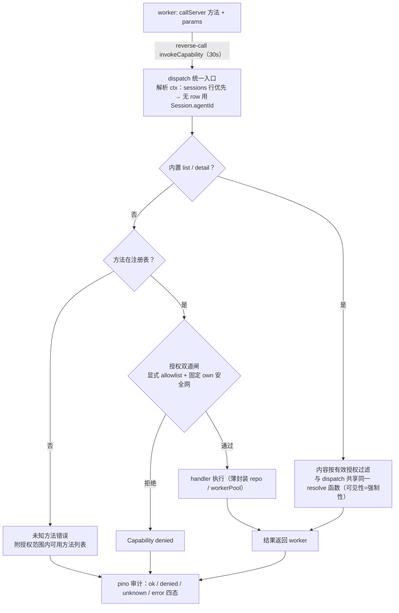

# pi-agent-server capabilities

> Agent → 宿主 server 的管理能力：`callServer` meta-tool + master 侧能力控制面。
> 加 / 下线能力只动控制面注册表一处，worker 与 IPC 协议零改动。

## 总览

```
┌──────────────────────── worker（session 创建时）────────────────────────┐
│  RuntimeConfig.capabilityIndex（master 下发：按该 session 有效授权过滤）│
│        ↓ 拼进 description                                               │
│  ToolDefinition: callServer  { method: string, params?: object }        │
│    promptSnippet / promptGuidelines → system prompt                      │
│    execute → callMaster('invokeCapability', [method, params])            │
└────────────────────────────────────┬─────────────────────────────────────┘
                                     │ reverse-call IPC（30s 超时）
┌────────────────────────────────────▼─────────────────────────────────────┐
│ master：capabilities/ 控制面（唯一收口，index.ts 启动时注册一次）         │
│                                                                          │
│  dispatch（统一入口，dev-only /debug/capabilities/invoke 也走这条路径）  │
│   1. 解析 ctx（sessionId → agentId：sessions 行优先，placeholder          │
│      无 row → Session.agentId）                                          │
│   2. 内置方法 list / detail → 内容按授权过滤（detail 未授权拒绝）        │
│   3. 业务方法：方法存在？ → 授权（双道闸）→ handler → pino 审计          │
│   4. 未知方法错误附「授权范围内」可用方法列表                             │
│                                                                          │
│  registry.ts   注册表（唯一事实源）+ 授权解析共享函数                    │
│  authorize.ts  双道闸 + CapabilityDeniedError + 固定 own 安全网          │
│  audit.ts      每次调用一条结构化审计（ok/denied/unknown/error 四态）    │
│  handlers/     server.ts | agent.ts | session.ts                         │
└──────────────────────────────────────────────────────────────────────────┘
```

### dispatch 决策流程



## 四道配置（互不混淆）

| 字段（`AgentConfig`） | 管什么 | 生效层 |
|---|---|---|
| `builtinTools` | 工具启用清单，**清单里只放工具名**：① pi 内置工具（`read` / `write` / `edit` / `bash` / `grep` / `find` / `ls` / `powershell`）；② pi 内置**扩展**工具（`codemode` / `tool_search`）——名字在清单里时 worker 装载 `builtin:<ext>` 并激活对应工具。**缺失 / null = 空=全不启用**。**`mcp` 不是工具，不在本清单**（历史遗留值会被忽略） | worker：`additionalExtensionPaths` + `extensionFactories` 注入 + `setActiveToolsByName`（非内置的 sdk/扩展工具始终激活） |
| `mcp` | MCP 能力开关 `{ enabled?: boolean }`：`true` = worker 装载 `builtin:mcp` + 补齐 `codemode` / `tool_search` 依赖。**缺失 = `{enabled:false}`** | worker：同上的两步注入；激活不过白名单（MCP 工具按 per-server `exposure` 由 pi 决定） |
| `serverBuiltinTools` | server 侧工具注入白名单（`sendFileToUser` / `callServer`），**缺失 = `[]` = 全不给**（平台基础配置模板勾 `sendFileToUser`，callServer 永不预置） | worker customTools 注入 = prompt 可见性 |
| `capabilities` | `callServer` 方法级授权：**缺失（null/undefined）= opt-in 无任何方法权限**，[]=全禁，数组=精确白名单（session 行缺 key 时回落 agent 行的既有快照语义不变） | master 控制面 dispatch 强制校验 |

四字段都在 `AgentConfig` JSON 列（agents / sessions 共用），加字段零迁移。

**单层显式清单（无继承层）**：所有配置字段都"缺失即空"，全局 `~/.pi/server/config.json` **不再承载任何 `default*` 资源默认值**（已删除）——一个 agent 的生效清单完全由它自己的行决定。归一在写入与 spawn 两处走同一个 `normalizeAgentConfig()`（`services/session.ts` + `routes/agents.ts` + `routes/sessions.ts`，规则在 `packages/shared-types`）。存量行由前端打开时按同一份规则归一后显示；**不存在迁移代码**。

列表里的值在当前环境不存在（工具 / 插件 / Skill / Prompt / capability / 模型）时：不阻断保存，但读写响应带 `issues[]`（`findConfigIssues`），三处 UI 渲染黄标 + 原因 +「清理无效项」。旧的全选语义 = **展开成当时的显式清单**（不在存储里引入 `*` 特例）。

### `builtinTools` 清单与内置扩展装载

`builtinTools` 是**工具名**的唯一来源，worker 按名分派到扩展装载（见 `workers/session-worker/src/builtin-extensions.ts`）：

| 名字 | 扩展名 | 装载后果 |
|---|---|---|
| `codemode` | `codemode` | 注入 `codemode` 扩展：模型写 JS 在一次调用里编排多个工具（沙箱内可调所有已启用工具，中间结果不进上下文） |
| `tool_search` | `tool-search` | 注入 `tool-search` 扩展：未对模型声明的工具（`codemode` / `deferred` 形态，例如 MCP 工具）由 BM25 按需检索加载为直接声明 |
| `llama.cpp` | —— | **不映射**：它 `registerProvider`（模型 provider），不是工具 |

### `mcp` 能力（独立开关 + 平台目录选 server）

MCP 单独成能力（`AgentConfig.mcp = { enabled, servers }`，三处 UI 渲染为「MCP」区块）：

- **为什么不做成工具名**：勾 `mcp` 注册的是 `mcp__<server>__<tool>`（rea 一个 server 就 170 个），`mcp` 本身不是工具。
- **定义 vs 选择分离**（change `platform-mcp-catalog`）：server 定义只维护一份，在平台目录 `<userDataDir>/mcp.json`（默认 `~/.pi/server/mcp.json`，env `PI_SERVER_MCP_CONFIG` 可覆盖，格式与 pi 的 `mcp.json` 完全一致）。DB 只存**名字**：`mcp.servers`。
- **按 agent 注册**：worker 在扩展装载期把选中的条目通过 `pi.registerMcpServer(name, config)` 注册，pi 内置 `mcp` 扩展在 `session_start` 连接它们。未选中的 server 不连接；单条注册失败只记 error 并跳过。
- **装载 = `builtin:mcp` + 依赖补齐**：至少一个 server 解析成功时 worker 注入 `mcp`，并把 `codemode` / `tool_search` 补进注入与激活集合（`MCP_DEPENDENT_TOOLS`）——目录里默认 `exposure: 'codemode'` 需要 codemode 工具，`deferred` 需要 tool_search。零 server 时不装载 mcp、不补依赖，只记一条 warn。
- **关闭保留选择**：`enabled: false` 只撤 MCP 扩展，`servers` 原样保留（选择不是授权），`codemode` / `tool_search` 的用户勾选也保留。
- **pi 的同名 server 优先**：pi 仍会自己读 `~/.pi/agent/mcp.json` 与受信项目的 `.pi/mcp.json`；同名 server 由 pi 那份生效（平台注册被忽略）。平台把重叠名字暴露在 `GET /api/config/mcp-servers` 的 `conflicts` 并记 warn，UI 显示提示——否则「关掉却不生效」是静默 bug。
- **旧配置的 `builtinTools: ['mcp']`**：静默忽略（debug 日志），MCP 只由 `mcp.enabled` 驱动，无自动迁移。
- **工具可见性交给 pi**：per-server `exposure`（`codemode` 默认 / `deferred` / `direct` / `hidden`）与 `toolExposure` 决定模型怎么拿到工具。
- **不在白名单里过滤**：MCP 工具的 `sourceInfo.source` 也是 `builtin`（扩展路径 `builtin:mcp`），所以 `setActiveToolsByName` 的白名单过滤**必须显式跳过 MCP 工具**（`isMcpToolName`），否则 `exposure: 'direct'` 的 server 会被静默停用。
- **默认关闭**：`mcp` 缺失或 `enabled !== true` 即不装载（无全局默认层），三处 UI 默认不勾 → 存量项目零影响。

要点：

- **注入 = 两步**：factory 进 `extensionFactories`（且必须带 `builtin: true`，否则它被当成 `<inline:mcp>` 无条件装载、且 `builtin:mcp` 报 `Unknown built-in extension`）**且** `builtin:<ext>` 进 `additionalExtensionPaths`（触发装载）。缺一不可。
- **激活与注入同源**：内置扩展注册的工具 `sourceInfo.source` 也是 `builtin`（`getSyntheticPathSource('builtin:x')`），所以同一个白名单过滤既管纯工具又管扩展工具，不存在“装载了但没勾”；MCP 工具是唯一例外（见上）。
- **降级**：解析 `dist/extensions/index.js` 失败时只 warn，纯工具白名单照常工作（与 pi 目录结构耦合，见 changelog 032）。

## 授权模型（双道闸 + 快照语义）

- **道闸 1（prompt 层）**：`serverBuiltinTools` 决定 `callServer` 注不注入——模型看不见工具。
- **道闸 2（强制层，信任边界在 master）**：dispatch 时校验
  1. **显式 allowlist**（唯一授权来源）：`capabilities` 未配置 → 拒（错误提示 opt-in）；`[]` → 全禁；数组 → 白名单外拒。
  2. **固定 own 安全网（硬编码，不可配置）**：read=`all`（跨 agent 读可见）、write=`own`——`scoped` 写能力目标不属于调用方 agent/session 行即拒；归属解析不到 fail closed。
- **session 快照语义**：授权读取 = session 行 config **有 `capabilities` key**（数组或显式 null）→ 用 session 的；**缺 key**（存量 row，未快照过）→ 回落 agent 行。`null`（显式未授权）≠ `undefined`（没快照过）。
- **可见性 = 强制性**：`resolveAllowedCapabilityMethods` / `resolveEffectiveCapabilities`（registry 导出）被**五处共享**——authorize 判定、spawn 时 description 索引过滤、`list` 返回内容、`detail` 可查性、未知方法错误的可用列表。改授权语义只改一处。

## v1 能力清单（module 分组）

| module | 方法 | access / scoped | 生效时机 |
|---|---|---|---|
| server | `status` | read / — | 即时（config + workerPool 统计，无凭据） |
| agent | `list`（name/workspacePath/description 组合模糊）、`get` | read（get scoped） | 即时（内存过滤） |
| agent | `update` | write / scoped | **只影响未来 session**（完全快照） |
| session | `list`（agentId 精确 + title 模糊 + status）、`get` | read（get scoped） | 即时 |
| session | `update` | write / scoped | model/thinking=即时 IPC+DB；title=改名同步；**config.*=下次 spawn** |
| session | `restart` | write / scoped | kill + 复用 piSessionPath 重建；busy 拒、placeholder 404；**sessions 行与 session-channel-map 不动** |
| channel / config | （占位空组） | — | 注册即显示 |

内置方法（不参与 allowlist 调用拦截，内容按授权收敛）：

- `list { module? }` — 按 server/agent/session/channel/config 分组返回**已授权**业务能力
- `detail { method }` — 单能力完整 spec（paramsSchema + returns 含生效时机标注）；**未授权方法拒绝**

`session.update` 的 title 走共享 `services/session-ops.ts`（`renameSession`，HTTP 三入口与控制面同一实现）。

## 端点

| 路径 | 模式 | 用途 |
|---|---|---|
| `GET /api/capabilities` | 正式 | 只读能力元数据（method/module/access/scoped/summary）——WebUI 勾选列表唯一事实源，前端不硬编码 |
| `GET /debug/capabilities[?agentId=]` | dev-only | 完整状态：固定策略 + 注册表分组 + agent 字段解析 |
| `POST /debug/capabilities/invoke` | dev-only | synthetic ctx 走**真实 dispatch** 路径——授权矩阵 L1 测试入口（不烧 LLM token） |

两者均在组合根 `if (config.isDev)` 内 dynamic import（debug 三约束），`/debug/capabilities` 与 `/debug/*` 一起挂载。

## WebUI（三处）

1. **Agent 编辑**：Resources 区内 6 个分组（Builtin tools / MCP / Server Builtin Tools / Extensions / Skills / Prompts），每项带「全选 / 清空」，无效项「清理无效项」；Resources **外**独立 `Capabilities` 区（随 callServer 启用联动显隐，module 分组勾选 + 全选/清空，未配置显示“未授权”）。
2. **Session 编辑**：同款分组，打开即显示**生效值**（agent 归一值 + session 覆盖）；capabilities 为 session 快照级——缺 key 的存量会话展示 agent 当前值，**保存即固化**（不回写 agent），提示下次 spawn 生效。
3. **配置 → 默认设置**：只剩三项——默认模型（`provider/model`，保存拆分写 pi settings 的 `defaultProvider` + `defaultModel`）、默认思考等级、启用的模型。**不再有任何资源默认值**。
4. 三处共用 `composables/useConfigIssues.ts` 的黄标/清理逻辑。

## 注入到 prompt 的文本（两半）

- **systemPrompt**：`Available tools` 段一行（`- callServer: <promptSnippet>`，不带工具名前缀——pi 拼接自带）+ `Guidelines` 段的 promptGuidelines 逐行。
- **tool description**（tools 数组，不占 system prompt 长度）：`Available methods (authorized for this session)` 按授权过滤的方法清单（method + access/scoped + 一句话 summary）+ Builtins 使用说明 + 未知方法回退说明。

## 关键边界

| 谁负责 | |
|---|---|
| **master 控制面** | 注册、分发、授权（唯一强制点）、审计、能力索引下发 |
| **worker** | 只按 `serverBuiltinTools` 注入工具、把索引拼进 description、转发调用——**不做任何授权判断** |
| **AgentConfig（session 快照）** | 工具开关与方法授权的唯一配置来源（单层，无全局资源默认）；全局 config.json 只存通用设置 |

## 相关文档

- [`pi-agent-server_ipc.md`](pi-agent-server_ipc.md) —— `invokeCapability` 反向调用协议
- [`pi-agent-server_worker-pool.md`](pi-agent-server_worker-pool.md) —— 反向调用分发 + 注入式 hasRowQuery（`Session.agentId` 见 session-lifecycle）
- [`pi-agent-server_session-lifecycle.md`](pi-agent-server_session-lifecycle.md) —— respawn 配置读取（session 行优先）+ 完全快照语义
- [`pi-agent-server_db-schema.md`](pi-agent-server_db-schema.md) —— `AgentConfig` 字段
- [`pi-agent-server_http-api.md`](pi-agent-server_http-api.md) —— `GET /api/capabilities`
- [`pi-agent-server_debug-testing.md`](pi-agent-server_debug-testing.md) —— `/debug/capabilities*` 端点规范
