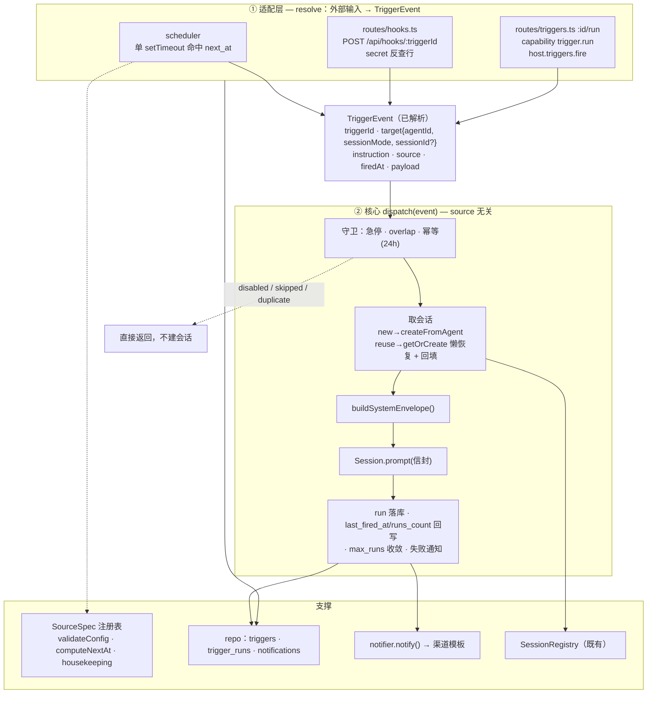
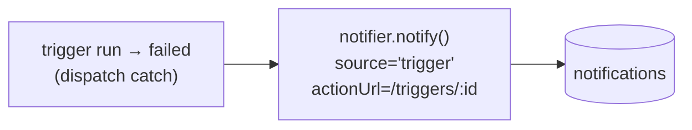

# 触发器（trigger-scheduling）

> agent 的"无人值守"入口：**触发器**决定它什么时候跑。结果怎么回到人，是**独立的系统通知子系统**的事——见 [`pi-agent-server_notifications.md`](pi-agent-server_notifications.md)。

对应代码：`apps/pi-agent-server/src/{services/trigger/*, services/system-envelope.ts, routes/{triggers,hooks}.ts, repos/trigger.repo.ts}`、`apps/pi-agent-web/src/views/triggers/*`。（`postNotification` 工具与收件箱属通知子系统，不在本文范围。）

---

## 1. 全景



**分工红线**：

| 层 | 可以做 | 不可以做 |
|---|---|---|
| 适配层（scheduler / hooks / run-now / `fire`） | 鉴权、幂等头、body 上限、读触发器行、组装事件 | 取会话、拼信封、投递、写 run |
| `dispatch(event)` | 守卫、取会话、拼信封、投递、run 与回写、`max_runs`、失败通知 | 为"用哪个 agent"再读 `triggers`；出现 `source === 'xxx'` 分支 |
| `SourceSpec` | `validateConfig` / `computeNextAt` / `housekeeping` | 注册 HTTP 路由、产出事件、碰会话 |

`TriggerEvent` 只允许由平台适配层构造（**不要**从 HTTP body / 插件入参映射字段）。

---

## 2. 数据模型

| 表 | 关键列 | 语义 |
|---|---|---|
| `triggers` | `agent_id` · `name` · `source` · `config`(JSON) · `prompt` · `session_mode`(`new|reuse`) · `enabled` · `next_at` · `max_runs` · `runs_count` · `session_id` · `last_fired_at` | 一行一个触发器；`next_at` 单独成列并建索引（scheduler 只扫它）；source 专属参数全在 `config`；`session_id` 只在 `reuse` 下有意义（见 §2.1） |
| `trigger_runs` | `trigger_id` · `status`(`fired|skipped|missed|failed`) · `triggered_by`(`schedule|webhook|manual|capability|plugin|system`) · `idempotency_key` · `started_at`/`finished_at` · `session_id` · `error` · `payload_bytes` | 一次触发尝试一行；`skipped` 的 `error` 写原因（`overlap` / `duplicate` / `disabled`） |
| `notifications` | 见 [`pi-agent-server_notifications.md`](pi-agent-server_notifications.md) §3 | **独立子系统**的表。触发器只是它的调用方之一（run 失败时写一行 `source='trigger'`） |

### 2.1 `session_id`：复用目标（可空）

`reuse` 模式下这一列是"这次触发写进哪个会话"，三态：

| 值 | 含义 |
|---|---|
| 有值 | **已绑定**：每次触发都写这个会话（idle 被回收后由 `getOrCreate` 自动恢复） |
| 空（null） | **未绑定**：首次触发自动创建一个会话，成功后回填到本列（此后固定复用） |

规则集中在 `services/trigger/session-binding.ts`（HTTP / capability / dispatcher 共用一份）：

- `sessionId` 只能在 `sessionMode='reuse'` 时给；`new` 模式下传了直接拒（**不静默丢弃**——静默丢字段最容易造出"两个人对写哪儿有不同理解"）
- 绑定目标必须存在且 `sessions.agent_id` 与触发器同源 → 否则 400（这是复用目标的 own-scope 边界）
- `PATCH` 语义：传值 = 换绑；传 `''`/`null` = 解绑回"首次触发时创建"；切到 `new` 时**自动清空**
- `dispatch` 会**再校验一次**：绑定的会话被删/换主时 run 直接 `failed`（`getOrCreate` 对未知 id 会照建一个，不校验就会静默写错地方），并写一条 error 通知进收件箱

---

## 3. 三个内置 source

| source | `validateConfig` | `computeNextAt` | 收尾 |
|---|---|---|---|
| `cron` | 5 段表达式 + IANA 时区；最小间隔 **5 分钟**（`* * * * *` 拒绝） | 自研解析（`services/trigger/cron.ts`）：wall-clock 逐分钟步进 + 一次时区换算（DST 二次校正），无第三方依赖；Feb-29 这类最坏 ~500k 次整数循环（~5 ms） | — |
| `once` | `at` 必须是将来（30s 宽限） | 就是 `at`；已过 → `null` | 创建时 `max_runs=1`；触发后 `runs_count>=max_runs` → 停用 |
| `webhook` | `secret` ≥16 位（创建/轮换时**服务端生成**，明文只在响应里出现一次） | 不实现（不参与扫描） | HTTP 入口是平台固定路由（见 §4） |

插件可以注册自己的 source（`host.triggerSources.register`），与内置同一张注册表、同一套校验、重名拒绝。fixture 见 `test-workspace/trigger-source-plugin/`。

---

## 4. HTTP 入口

```
POST /api/hooks/:triggerId          ← webhook 唯一入口（固定路由，source 不能注册路由）
  Authorization: Bearer <config.secret>
  Idempotency-Key: <可选，24h 去重 → duplicate>
  body ≤ 64 KiB（超出截断，run 记原始 payload_bytes）
```

- 按路径 `triggerId` 读行 → 校验 `source === 'webhook'` 且 secret 匹配（A 的 secret 调 `<B>` → 401，不落 run）
- body **原样**当数据（JSON 能解析就用解析结果，否则当字符串），里头的 `agentId` 之类只是 `<data>` 内容
- 响应：`202` dispatched / `200` duplicate / `401` 鉴权失败 / `404` 未知 id 或非 webhook source / `409` disabled·skipped·failed

管理面（web console 驱动，扁平不按 agent 分组）：

```
GET    /api/triggers?agentId&source&includeDisabled   → { items, sources }
POST   /api/triggers                                  { agentId, name, source, config, prompt, sessionMode, maxRuns? }
GET    /api/triggers/:id                              → TriggerDTO + recentRuns(20)
PATCH  /api/triggers/:id                              { name?, config?, prompt?, sessionMode?, enabled?, maxRuns?, reschedule? }
DELETE /api/triggers/:id
POST   /api/triggers/:id/run                          { payload? }
GET    /api/triggers/:id/runs?limit=
POST   /api/triggers/:id/rotate-secret                → { id, secret }（明文只此一次）
```

通知的读写端点在通知子系统里（`/api/notifications*`），与触发器无关。

**脱敏**：列表/详情里 `config.secret` 恒被替换为 `secretEnding`（末 4 位），只有 create 与 rotate 的响应带明文。

**会话绑定字段**：`POST /api/triggers` 与 `PATCH /api/triggers/:id` 都接受 `sessionId`（语义见 §2.1）；列表页展示的会话下拉复用既有 `GET /api/sessions?agent_id=`（不新增查询端点）。

---

## 5. 调度语义

| 情况 | 行为 |
|---|---|
| 正常到点 | 先 `claimNextAt(id, expected, next)` 条件更新抢占 → 组装事件 → `dispatch` |
| 抢占失败（run-now 已推进 slot） | 静默跳过该 slot（`claimNextAt` 是唯一互斥点） |
| 上一轮还没结束 | `skipped` + `error='overlap'`；overlap 只看 **30 分钟内**未收尾的 run（更老的视为僵尸） |
| 进程停机期间错过 | 启动时 `catchUp()` 只写一条 `missed`（`error` 含次数），`next_at` 推进到第一个未来 slot，**不补跑** |
| 僵尸 run（崩溃残留 `finished_at IS NULL`） | 启动时 `finalizeStaleRuns()` 标 `failed: stale`，否则 overlap 会永久卡死该触发器 |
| `PI_TRIGGERS_DISABLED=1` | scheduler 不 arm；四个入口一律返回 `disabled`（webhook → 409） |
| 停用后再启用 | PATCH 会**按 now 重算 `next_at`**（否则过期 slot 会在启用瞬间补跑）；`runs_count >= max_runs` 时拒绝启用（要求先提高 maxRuns） |
| `max_runs` 达到 | `enabled=0, next_at=null`（`disable()`，无 per-source 钩子） |

`once` 的 `housekeeping`：每天最多一次的 tick 里清掉 30 天前**已停用**的 `once` 行，`trigger_runs` 保留。

---

## 6. 信封（platform-level）

```xml
<system-event v="1" kind="trigger" source="cron" name="disk-check"
              fired="2026-11-06T09:00:00.000Z" run="<runId>">
  <instruction>（triggers.prompt 原文）</instruction>
  <data format="json">{"alert":"cpu 98%"}</data>
</system-event>
```

- 生成入口唯一：`buildSystemEnvelope({kind, source, name, fired, run, instruction, data})`；`buildTriggerEnvelope()` 是 trigger 场景的便捷包装
- 属性只放机器可读短字段；正文 `<instruction>`；外部数据 `<data format="json">`（仅 payload 存在时才有）
- 清洗只有一个点：`</data` → `<\/data`
- `<instruction>` 原样保留（它是 prompt 本身，转义反而破坏语义；唯一的终止符是 `</instruction>`）
- system prompt 约定由 worker 恒注入（`SYSTEM_EVENT_PROMPT_NOTICE`，shared-types 常量），与 agent 自己的 `appendSystemPrompt` 并存
- 消息模型没变：走 `Session.prompt()`，模型层看到的是 `role:"user"` + 信封文本；将来切 `sendCustomMessage` 只需换通道 + 4 处渲染，信封文本零变化

---

## 7. 与通知的关系（只有一条线）

触发器**不是**通知系统的一部分，只做一件事：run 变成 `failed` 时写一行系统通知。



- agent 想在跑完后主动汇报，是自己在会话里调 `postNotification` 工具（闸门 `serverBuiltinTools`），触发器不代劳
- 通知的模型、读写接口、收件箱 UI、以及"平台不投递"的取舍 → 全部在 [`pi-agent-server_notifications.md`](pi-agent-server_notifications.md)

---

## 8. 能力面与插件扩展点

**capability（module `trigger`，全部 `scoped: true` → own-agent 写）**：`trigger.list/get`（读，`scoped:false`）、`trigger.create/update/delete/run`（`create`/`update` 的 `sessionId` 与 HTTP 走同一个校验器）。`postNotification` **不是** capability（不是管理操作）。兜底常量：每 agent ≤10 个启用触发器、cron 最小间隔 ≥5 分钟。

**插件**：

```js
host.triggers.fire(triggerId, payload?)   // 走同一个 dispatch，triggeredBy='plugin'，payload ≤64 KiB
host.triggers.list({ agentId?, source?, includeDisabled? })
host.triggerSources.register({ source, validateConfig, computeNextAt?, housekeeping?, ... })
```

插件要 HTTP 入口时用 `host.global.routes` 自建端点再调 `host.triggers.fire`（平台不给 source 注册路由的口子，因为 Hono 路由表首次请求后冻结）。

---

## 9. Web 控制台

| 路由 | 作用 |
|---|---|
| `/triggers`（navOrder 15，icon `automation`） | 单表：名称/agent/source/计划/下次/上次/runs/状态 + 行内 ▶ ✎ 🗑（**不做行内展开**，runs 只在详情页） |
| `/triggers/new` · `/triggers/:id` | 表单按 source 渲染；`source`/`agent` 创建后只读；`reuse` 模式多一个「目标会话」下拉（该 agent 的会话，第一项 = 留空自动创建）；右栏最近 50 条 runs；webhook secret 弹窗**只显示一次** |
| `/notifications`（header 铃铛 badge → 此页，`mobileHidden`） | 只读收件箱（属通知子系统，见其文档） |


---

## 10. 已知边界

- **不做权限收窄**：触发器必须绑专用 agent；交互 agent 不该挂触发器（本期靠约定，不靠代码）
- **不做 webhook 语义**：无条件过滤/字段模板/去抖/重试——事件逻辑留在外部系统，平台是哑端点
- **不做通知合并/digest/分诊**：语义交给 prompt，平台只记事实（详见通知子系统文档）
- **不做重试与补跑**：失败只记录；错过只记 `missed`
- 会话归因靠标题前缀与 `session_id` 回填，`sessions` 表无 `creator`/`origin` 列（**改表要等权限那条线一起做**）
