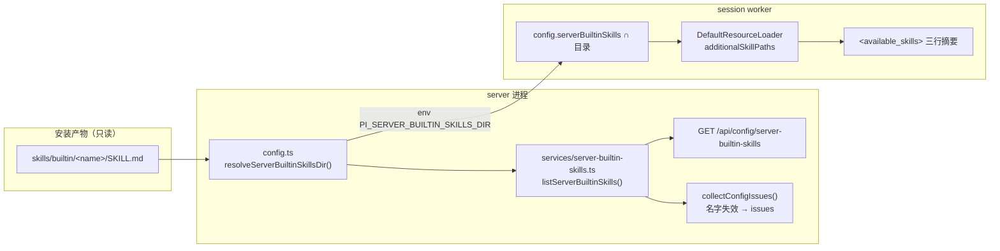

# 平台随包 Skill（serverBuiltinSkills）

> 平台自己发的 skill：**随包发布、只读、按名字显式勾选**，与用户的 `~/.pi/agent/skills` 是两套名字空间。

对应代码：`apps/pi-agent-server/skills/builtin/<name>/SKILL.md`（内容）· `src/services/server-builtin-skills.ts`（清单）· `src/config.ts`（目录解析）· `src/worker-pool.ts`（环境下发）· `workers/session-worker/src/session.ts`（注入）· web `views/agents/AgentEditorView.vue` / `views/sessions/SessionDetailView.vue` / `components/templates/TemplateResourceForm.vue`。

---

## 1. 为什么单独一条资源轴

`AgentConfig` 里 `skills` 与 `serverBuiltinSkills` 并存，不是冗余：

| | `skills` | `serverBuiltinSkills` |
|---|---|---|
| 来源 | 用户磁盘（`~/.pi/agent/skills`、`<cwd>/.pi/skills`） | 平台随包（安装目录内 `skills/builtin/`） |
| 生命周期 | 用户增删改 | 随版本发布，只读 |
| 清单接口 | `GET /api/config/skills`（有 PUT/DELETE/upload） | `GET /api/config/server-builtin-skills`（**只读，无写路径**） |
| 页面 | `配置 → Skill` | 只在 agent / 会话 / 模板的配置表单里 |
| 名字冲突 | 可能用户同名覆盖 | 独立命名空间，不会互相挤掉 |

命名与 `serverBuiltinTools` 对齐：**平台提供、按名字显式启用、缺失即空（全关）**。

---

## 2. 数据流

- **目录解析**用候选列表（dev `src/` 与打包 `dist/server/` 深度不同），全都不存在 → `undefined` + warn，**不阻断启动**（裁剪安装仍能跑，清单为空、配置里的名字报无效）。
- **下发方式**是环境变量而非 IPC：worker 已经通过 `RuntimeConfig.config` 拿到"选了哪些"，只缺"目录在哪"这一个纯路径信息。`worker-pool.spawn()` 与 `PI_AGENT_DIR` / `PI_SERVER_MCP_CONFIG` 同一处注入。
- **求交集**：worker 把 `config.serverBuiltinSkills` 里每个名字拼成目录，只把真有 `SKILL.md` 的塞进 `additionalSkillPaths`；选了但不存在 → warn 不抛错。

---

## 3. 关键契约：绕过白名单是**故意的**

pi 的 skill scope 由物理位置判定（`loadSkills()` 的 `getSource` + `getDefaultSourceInfoForPath`）：

| 位置 | scope | 是否受 `skillsOverride` 白名单约束 |
|---|---|---|
| `~/.pi/agent/skills` | `user` | 是 |
| `<cwd>/.pi/skills` | `project` | 否（`isAlwaysKept`） |
| 其他任意位置（含安装目录） | `temporary` | 否（`isAlwaysKept`） |

所以 `additionalSkillPaths` 注入的内置 skill 天然**不受用户 `skills` 白名单影响**：

- 用户 `skills: []`（一个用户 skill 都不给）**不会**杀掉内置 skill —— 正确，它们是两种资产；
- 反过来，**白名单也不能用来关内置 skill** —— 开关只能是 `serverBuiltinSkills` 本身。

`workers/session-worker/src/resource-filters.ts` **零改动**，`session.ts` 注入处有注释解释这一点。新增内置 skill 时不要尝试给它加白名单特例。

---

## 4. 首轮发布的三份 skill 与边界

| skill | 回答的问题 | 明确不写 |
|---|---|---|
| `pi-capabilities-usage` | 怎么查/改平台状态、为什么被拒、什么时候生效、写操作最小权限 | 触发流程（一句指针转上一条） |
| `pi-plugin-authoring` | 给平台加功能：插件形态、四类 facet、扩展点清单、硬约束、最小示例与自测 | capability 授权模型（只在涉及 `host` 权限时提一句） |

**切分标准是任务粒度，不是能力模块粒度**：`prompt` 里只放 `name` + `description` + `location` 三行（模型据此决定要不要 `read`），所以 `description` 就是"何时读这份"的判据，合并会让命中面变宽、精度下降。三份合计 `<available_skills>` 段约 1.5K 字符（≈500–700 token），成本由 `description` 长度主导。

`pi-plugin-authoring` 还带了**两份可安装示例工程**（`examples/hello-plugin/`、`examples/kitchen-sink/`，零依赖纯 ESM，`package.json` 必须 `"type": "module"`）——pi 的 skill 约定是"相对路径按 `SKILL.md` 所在目录解析"，所以模型能直接 `read` 到真代码，复制出去就能 `pi-server plugin add`。

> 依赖前提：`<available_skills>` 段只在 `read` 在活跃工具集时才注入（`workers/session-worker/src/session.ts` 的条件拼接），模型也要靠 `read` 打开文件。所以 agent 页对"勾了平台 skill 但没开 `read`"给软提示。

---

## 5. 归一、校验、软提示

| 环节 | 行为 |
|---|---|
| 归一 | `normalizeAgentConfig`：`serverBuiltinSkills ?? []`（缺失/`null` = 全关，**没有默认开启**） |
| 校验 | `findConfigIssues` 的 `serverBuiltinSkills` 字段：名字不在当前版本清单 → 黄标「平台 Skill 不存在或未随此版本发布」+ 清理按钮 |
| 软提示（不拦保存） | ① 授权了任一业务能力但没勾 `pi-capabilities-usage`；② 勾了平台 skill 但 `builtinTools` 没有 `read` |
| 会话快照 | 与其它资源字段一致：`sessions.config` 快照优先，改动只影响**新建**的会话 / 下次 spawn |

---

## 6. 打包与自检

| 环节 | 要求 |
|---|---|
| `build-cli.mjs` | 新增 step 复制 `apps/pi-agent-server/skills` → `cli/dist/server/skills`（`tsc` 不搬 `.md`） |
| `check-packaged.mjs` | 断言三份 `SKILL.md` + 两份 `examples/*/package.json` 存在；缺了**不产 tgz** |
| 运行时定位 | 打包态 `config.js` 落在 `dist/server/` → 命中候选 `./skills/builtin`；实测 `config.serverBuiltinSkillsDir` = `…/dist/server/skills/builtin` |
| 端到端验证 | dev：清单接口 → 勾选 → 新会话 `<available_skills>` 出现 → 取消勾选 → 新会话消失；packaged-test：安装后清单非空 + 示例插件能装 |

---

## 7. 已知边界

- **不做热加载**：`SKILL.md` 内容随包发布，改文案要重新打包/重启；清单有 2s 缓存（dev 改文件后最多 2s 生效，注入发生在 spawn）。
- **不做用户可编辑**：内置 skill 不可在页面改、不可上传覆盖。要定制请复制到 `~/.pi/agent/skills`（那时它就成了用户 skill，归 `skills` 管）。
- **不与应用层权限耦合**：本轮是"显式勾选"，不做"授权了某能力就自动附带某说明"的隐式映射（曾评估「跟着 capabilities 自动附带」方案后否决，理由同前；完整讨论在私域想法库 `builtin-skills-and-trigger-usage`）。
