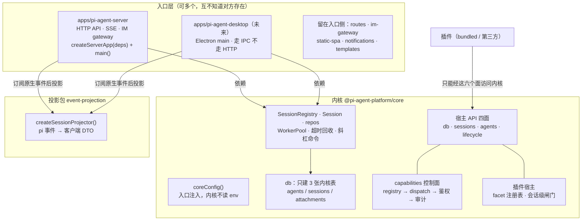

# pi-agent-server core-sdk

> 会话内核（`@pi-agent-platform/core`）：包边界、宿主 API、订阅契约、以及"内核能不能脱离 HTTP 跑"的可执行验收。
>
> 一句话：**`pi-agent-server` 退化成入口之一**，内核与投影被抽成可被任意进程引用的包。

## 为什么要分层

在此之前，"内核"和"应用"是同一个东西：`db/`、`repos/`、会话服务、worker 池、能力控制面、插件宿主全都在 `apps/pi-agent-server/src/` 里面。后果是**任何第二个入口都做不到**——想在桌面端（Electron main 进程）用同一套会话能力，只能复制一份、或者把整个 HTTP server 塞进去。

同时投影（pi 原生事件 → 客户端 DTO）发生在 worker 内部，而它服务的是 **UI**，不是内核。worker 因此背着约 250 行纯展示逻辑，并且为了"只发 UI 关心的"维护一张事件白名单，白名单外的信息（`willRetry`、`tool_execution_update`、`compaction_*`）在出 worker 之前就被丢掉了。

切片之后：



依赖方向**严格单向**：入口 → 内核。内核不依赖任何入口，也**不依赖投影包**——它不知道 UI 长什么样。这条不变量有可执行断言（见下文「验收」）。

## 内核里有什么

| 目录 / 模块 | 内容 |
|---|---|
| `db/` | schema（**只有 agents / sessions / attachments 三张表**）+ `initDb` |
| `repos/` | `agent.repo` / `session.repo`（附件由 `attachment-store` 直接操作） |
| `services/session.ts` | `Session` / `SessionRegistry`——会话能力的唯一入口 |
| `services/`（其余） | `session-ops` / `prompt-resolver` / `attachment-store` / `extension-utils` / `plugins`（解析与闸门）/ `server-builtin-skills` / `plugin-extensions`（插件 facet 注册表）/ **`system-envelope`（信封唯一构造点）** / **`event-bus`（插件广播：声明 + 订阅）** / **`plugin-services`（插件定向调用：提供者表）** |
| `worker-pool.ts` | worker 子进程池（进程域 only） |
| `session-timeout-scanner.ts` | placeholder 超时回收 |
| `slash-commands.ts` | 会话级命令 |
| `capabilities/` | 能力控制面：registry → dispatch → authorize → audit + 基础能力组（server / agent / session） |
| `logger.ts` · `utils/normalize-path.ts` · `config.ts` · `host-api.ts` | 基础设施与契约 |

**不进程内核的**（留在入口侧）：`routes/`、`im-gateway/`、`static-spa`、`startup-banner`、`model-registry`、`config-issues`、通知模块（`notifier` + `notification.repo` + 路由）、配置模板模块（`template.repo` + 路由）、插件 web/server facet 的 HTTP 暴露。

### 硬规则：内核只建内核对象的表

`initDb` **只创建 Agent / Session / 附件三张表**。其余表由所属模块在装配时执行自己的迁移创建（渠道包早就是这么做的：`host.executeMigration()`）。

```ts
// 入口组合根
const { db, raw } = initDb(config.databasePath);      // 3 张内核表
const migrated = runModuleMigrations(raw);            // 平台功能模块自己的表
```

理由：

- 内核不认识"通知"和"配置模板"这两个概念，它的 schema 里不该出现它们
- 模块下线（这些功能未来可能变成插件）时，表跟着一起走，内核零改动
- 未加载的模块不该在库里留下空表

这条规则有可执行断言：内核验收脚本会在空库上执行 `initDb`，然后断言"只存在 `agents / attachments / sessions`"，多一张就失败。

## 配置注入：内核不读环境变量

内核**不读 env、不推算路径**——那是"这个进程怎么被启动"的知识，属于入口。内核只声明它需要知道哪些值：

```ts
initCoreConfig({
  maxWorkers, agentDir, attachmentsDir, pluginsDir,
  serverBuiltinSkillsDir, mcpConfigPath,
  workerStartupTimeoutMs, workerStopTimeoutMs, isDev,
});
```

未注入时 `coreConfig()` 立即抛错，而不是回落到默认值静默生效。

> 实现注意：内核里有**模块级单例**（`export const workerPool = new WorkerPool()`），它们的构造发生在 import 期，早于组合根注入配置。所以「构造时读配置」是错的，必须改成**读时解析**（`maxWorkers()` 在首次 `spawn` 才求值）。

## 宿主 API：插件与内核之间唯一的稳定缝

插件最终要访问内核（建会话、读写自己的表、注册反向方法、发事件），但它们**不能 import 内核内部模块**——那样每次内核重构都会打断插件，且插件之间可以互相穿透。

所以契约收敛成**六个**面（形状在内核，实现在组合根）：

| 面 | 内容 |
|---|---|
| `db` | `migrate(name, ddl)`（幂等 + 记台账）· `query(sql, params?)`（读写都开放，走审计日志） |
| `sessions` | `call(sessionId, method, args?)`（**唯一调用口**）· `get` · `list` · `status` · `hasRow` · `subscribe` · **`ensure`** · **`systemEvent`** |
| `agents` | `list` · `get` · `update(id, patch)` |
| `lifecycle` | `onSessionCreated` / `onSessionDisposed` |
| `bus` | `declare(topic, { declaredBy })` · `publish` · `publishAndWait` · `subscribe` · `topics()` —— **进程内广播**（0..n）：topic 先声明，owner 双向管控，**handler 返回值运行时丢弃** |
| `services` | `provide(name, fn)` · `call(name, payload)` · `list()` —— **进程内定向调用**（恰好 1 个提供者）：返回业务数据、错误外抛、无会话上下文 |

**为什么从六个收到四个、之后又加回两个**（`plugin-mechanism-v2` / `scheduler-plugin` / `plugin-interop-contract`）：

- `web`（`assetBasePath`）本质是"入口怎么托管资源"，属 HTTP 接入层，内核不该知道
- `events` 只有一个 `maxPayloadBytes` 常量，是出口限流参数，不构成能力；插件侧的 `emit` 在 worker bridge 上
- `outbound`（反向方法注册）是**注册面**而不是能力面 → 变成 `host.methods.handle`，由装载器 flush 到 `WorkerPool.registerService`
- **`bus` 是后来加回的**（`scheduler-plugin`）：通知与定时任务都是插件，定时任务的 run 失败要进收件箱，但插件之间不能互相 import。`bus` 是那个匿名的交汇点 —— 发布方与订阅方**互不相识**。它不叫 `events`：`host.events` 已被"worker → server → SSE"的事件出口占用
- **`services` 是第七个（也是最后一个）**（`plugin-interop-contract`）：`bus` 只能广播、只能回`{ delivered }`，而"问别的插件要数据"没有第一等机制 —— 唯一的候选是面 worker 的反向方法表，但它带 `sessionId`、按分层只服务自己的 facet。于是另开一面，**两张表彻底分开**（见下节「插件互操作的三个面」）

`WorkerPool` 明确**不作为面暴露**：暴露 = 插件能决定杀进程 / 超卖并发。需要"活跃会话"信息的地方用 `sessions.list/status`。

插件侧看到的 `host` 比内核的面多出注册面（`ui` / `http` / `methods`）与事件出口 `events`（仅 worker 侧可发），见 [插件运行期 v2](pi-agent-server_plugins-runtime.md)。

### `sessions.ensure` —— 无人值守跑一轮的入口

```ts
ensure({ agentId, sessionId?, title? }): Promise<{ sessionId, created }>
```

| 入参 | 行为 |
|---|---|
| 无 `sessionId` | `createFromAgent()` 生成 id + 占位 worker，再 `getOrCreate()` 落行 → `created: true` |
| 有 `sessionId` | 行必须存在且 `agent_id` 相同 → 懒恢复 → `created: false`；否则**抛错**（fail closed） |
| `title` | 只在新建时写（归因用，不动 sessions schema） |

`fail closed` 是关键：`getOrCreate` 对陌生 id 会照建一个会话，所以"绑定目标被删/换主"必须在这里被拦住，否则会静默写到别人的会话里。

### `sessions.systemEvent` —— 信封的唯一投递口

```ts
systemEvent({ sessionId, kind, source?, name?, run?, instruction?, data?, streamingBehavior? }): Promise<void>
```

内核把结构化字段拼成 `<system-event>` 信封（`services/system-envelope.ts` 的 `buildSystemEnvelope()` 是**唯一**构造点），再 `prompt` 进去。**返回即"送到"**：不等 agent 跑完，也不判断它干得怎么样。

`streamingBehavior`（`'steer' | 'followUp'`）原样转给 pi 的 `prompt`：pi 在 agent 正在流式输出时**必须**拿到它，否则直接报错。内核**不解释**这个字段的业务含义 —— 排队 / 插队 / 干脆别投，是调用方插件按自己的业务决定的（定时任务与 webhook 各有 `busy_policy`，取值还多一个 `skip` 由插件自己判 `sessions.status`）。不传 = 现状，既有调用方零影响。构造在 `systemEventPromptOptions()`，`verify:sdk` 断言三个分支。

为什么信封归内核：它是**平台契约**（模型看到的文本必须统一，`SYSTEM_EVENT_PROMPT_NOTICE` 也在 shared-types 里统一注入）。让每个插件各拼一份，等于让"外部文本能否注入标签名/属性"取决于各插件的自觉。

## 订阅契约

`Session.subscribe` 是内核的**公开广播契约**，也是"多渠道同时收事件"的唯一正确入口。

- **多订阅者**：任意数量，各自收到同一份**原生事件流**（不是 DTO）
- **幂等退订**：返回的函数可重复调用
- **终态通知**：会话进入终态时通知每个订阅者并清空
- **慢订阅者：丢弃，不回压**

最后一条的实现：每个订阅者一条**有界队列**（256 条），由 `setImmediate` 异步排空；队列满了丢最旧的一条并计数，首次丢弃记一条 warn（含 sessionId / 事件名 / 丢弃数）。

### 插件互操作的三个面（`bus` / `services` / `methods`）

三个都是"插件之间说话"，但基数和缺失语义完全不同 —— **合并会逼出 `{ sync: true }` 这种变体**，所以各一张表：

| 面 | 谁跟谁说 | 基数 | 返回 | 缺了 |
|---|---|---|---|---|
| `bus`（广播） | 任何插件 → 任何插件 | 0..n | `{ delivered }` / `{ handled, failed }`，**handler 返回值丢弃** | 正常（`delivered: 0`） |
| `services`（调用） | 任何插件 → 某个插件 | **恰好 1** | **业务数据** | 错误（`unknown service`） |
| `methods`（反向 IPC） | 本会话 worker → 自己的 server facet | 1 | 业务数据 | `unknown method` |

`methods` 那张表（`worker-pool.ts` 的 `reverseRegistry`）**不参与跨插件**：按分层，worker 只跟自己的 server facet 说话，`plugin.<id>.*` 里每一条天然全 private —— 所以它连"公开/私有"标记都不需要。

#### 广播（`host.bus`）的语义

- **必须先声明**：`declare(topic, { declaredBy })`，topic 前缀 MUST 等于声明者 id ⇒ 声明权与所有权天然一一对应，冒名在结构上不可能
- **owner 双向管控**：`declaredBy: 'publisher'` → 只有声明者能发（防冒名）、谁都能订阅（这才是广播）；`declaredBy: 'subscriber'` → 只有声明者能收（防抢单）、谁都能发（能力地址）
- **返回状态而非 void**：未声明 → `{ ok:false, reason:'unknown-topic' }`；0 订阅者 → `{ ok:true, delivered:0 }`（正常态）
- **同步派发**：订阅者在 `publish` 的调用栈里跑（订阅者自己必须轻）；`publishAndWait` 会等最慢的一个，默认 5s 超时不取消
- **抛错隔离**：单个订阅者抛错只计入 `failed`，不外抛给发布方
- **返回值被丢弃**（运行时强制）：于是"业务数据必须走 `services`"从文档约定变成机制 —— 即使有人 `subscribe` 里 `return {n:7}`，那 7 也到不了发布方
- **pending 订阅**：订阅未声明的 topic 不报错，返回 `state:'pending'`，声明时自动接上（装载顺序 = 目录扫描顺序，init 时校验存在必 flaky）
- **退订进插件账本**：disposer 由装载器按插件 id 记账，卸载归零（`disposePlugin` 一并清声明与提供者）

**四个注册表分开，只共享 disposer 账本**：extensions store（菜单/页/路由/槽位/工具卡）· `topics` · `providers` · 反向 IPC。理由是空态含义不同 —— topic 可以"声明了但 0 订阅者"（契约在、实现不在），provider 没实现就没这行（错误），两者塞进一张表就得给每行加 `kind` 分支。

#### 定向调用（`host.services`）的语义

- `provide(name, handler)`：短名由宿主补前缀（`task.list` → `scheduler.task.list`），重复提供被拒（`duplicate`）
- `call(name, payload)`：返回 handler 的业务返回值；错误透传；未提供 → 抛 `unknown service`
- `list()`：`[{ name, owner }]` 目录
- **无会话上下文**：`services.call` 的 `(payload) => result` 里没有 `sessionId` —— 需要"替某会话做事"的调用方自己传，或者干脆走 `sessions.call`

为什么广播不排队而是丢弃：事件是 UI 增量、本身可丢（与"事件无回执"同语义）；为一个卡住的消费者排队，等于让整条流陪它一起卡。需要确认的操作走请求-响应通道（`prompt` / `abort` / `services.call`），不受影响。

诊断面：`GET /api/runtime/interop` → `{ topics, services }`（谁声明、谁在听、末次发布）；`GET /api/plugins/:id/extensions` 附该插件的切片。

## 能力控制面在内核，平台功能能力组不在

能力控制面的注册表、分发、鉴权、审计，以及操作内核自身对象的基础组（server 运行时 / agent 行 / 会话生命周期）都在内核里。理由：

1. **它是 agent → 宿主的唯一授权与审计边界**，必须单实例。第二个入口自己实现一遍 = 安全实现分叉，而这类分叉用户看不见
2. 基础能力组操作的就是内核自己的对象（`session.restart` 碰 Session 对象、`agent.*` 碰 agent 行），放入口等于允许绕过 `SessionRegistry` 改内核状态
3. `createSession` 需要 `capabilityIndex` 才能拼参数；不进内核就得注入，而注入空实现意味着第二个入口没有 `callServer`

**边界**：未来的平台功能能力组（渠道、调度等）通过宿主 API 注册进来，不长在内核内部。所以"能力控制面在内核"与"触发器做成插件"不矛盾——机制在内核，能力组跟功能走。

## 入口：装配与启动分离

入口应用把两件事拆开：

```ts
// app.ts —— 纯装配，可被任意进程 mount
createServerApp(deps): { app: Hono; dispose(): Promise<void> }

// index.ts —— 启动器：读配置 → 建依赖 → 调工厂 → listen → 进程信号
main()
```

`dispose()` 只停**工厂启动的东西**（插件运行期、渠道网关、超时扫描）；worker 池与数据库句柄归启动器关。

为什么必须拆：桌面端内嵌 HTTP 是合法形态（"在自己进程里提供一个本地 API"），若入口不是工厂，内嵌就只能靠 fork 子进程。

## 验收：可执行，不是规则

`pnpm verify:sdk`（`scripts/verify-sdk.mts`）做两件事：

**A. 依赖闭包静态断言**——递归解析内核与投影包的 import 图，禁止出现 `hono` / `@hono/node-server` / 静态托管模块 / 入口应用模块。用可执行的检查代替口头边界规则：规则会腐化，检查不会。

**B. 无 HTTP 进程内跑一轮真会话**——`initCoreConfig` → `initDb` → repos → `WorkerPool` → `SessionRegistry` → 建 agent / 建会话 → 发一条消息 → 收原生事件 → 投影出客户端 DTO，并断言内核只建了 3 张表。

> 运行时坑：从 IDE / 已安装的 `pi-server` 里启动脚本时，环境里带着 `PI_SERVER_CLI` + `WORKER_DIST_DIR`，worker 会去 spawn **全局安装的 dist**，于是"跑的是另一份代码"且不报任何错。验收脚本必须像 dev 启动器一样先剥掉这些变量。同理，`resolveWorkerEntry()` 的第一个候选必须**从本文件解析**而不是从 `process.cwd()`——否则任何 cwd 不在 app 目录的宿主都会静默 fallback 到 stale `dist`。

## 打包要求

内核与投影包都是**运行期 import 的 workspace 包**，因此：

- 必须进 `RUNTIME_PACKAGES`（与 `check-packaged.mjs` 共用一份清单）
- 改动跨包 runtime import 后**必须跑一次 `pnpm pack:cli`**（dev 态 tsx + pnpm symlink 会静默掩盖缺包；历史上漏一个包就是"dev 全绿、用户装完启动即 `ERR_MODULE_NOT_FOUND`"）
- 编译前要清 `apps/pi-agent-server/dist` 与 `workers/session-worker/dist`：**tsc 不会删除"源文件已删"的旧产物**，不清就会把搬走的模块残留打进 tarball

## 相关文档

- [`pi-agent-server_ipc.md`](pi-agent-server_ipc.md) —— 事件层：原生事件与投影的分工
- [`pi-agent-server_worker-pool.md`](pi-agent-server_worker-pool.md) —— worker 进程域与反向注册
- [`pi-agent-server_capabilities.md`](pi-agent-server_capabilities.md) —— 能力控制面
- [`pi-agent-server_plugins.md`](pi-agent-server_plugins.md) —— 插件机制（宿主 API 的消费方）
- [`pi-agent-server_overview.md`](pi-agent-server_overview.md) —— 整体定位与分层图
