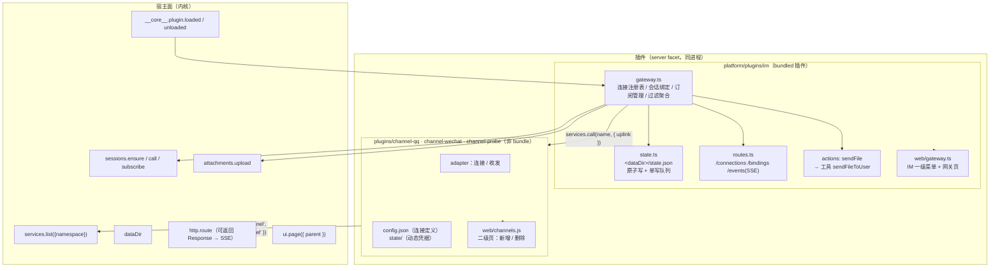

# pi-agent-server im-gateway

> IM 网关（bundled 插件 `platform/plugins/im/`）+ 渠道插件（非 bundle）。允许用户通过 QQ / 微信 / 自定义渠道跟 agent 对话。
> 状态：**已实施**（`change: im-as-plugin`）。真机验证（扫码登录 + 真实收发）由用户在装了插件的实例上做。

## 一句话边界

**网关不认识任何具体渠道；渠道不认识 agent 与 session。** 两边只靠 `im.channel` 这个 namespace 上的一个 service 相连，
provider 返回的 `ChannelDriver` 形状由 im 插件发布的协议包（`channel-api.ts`）约定 —— 平台对这两者一无所知。

判据：把 `im` 插件 `enabled:false` 之后，平台仍能建 agent、开会话、聊完一轮（只是没有 IM 入口）。

## 全景



## 契约（gateway ↔ 渠道）

依赖倒置：**只有网关调渠道**。因为插件装载无序，"渠道启动时去 call 网关"在网关后装载时必然 `unknown service`。

| 方向 | 接口 | 实现方 |
|---|---|---|
| 注册 | `services.provide('<pluginId>.channel', factory, { namespace: 'im.channel' })` | 渠道 |
| 取驱动 | `services.call(entry.name, { uplink })` → `ChannelDriver` | 网关调用 |
| 新增连接 | `uplink.declare({ id, label })` | 网关实现（渠道触发） |
| 删除连接 | `uplink.retire(id)` | 网关实现（渠道触发） |
| 上行 | `uplink.onInbound({ connectionId, chatId, userId?, text, attachments? })` | 网关实现 |
| 状态 | `uplink.onStatus({ connectionId, status, error? })` | 网关实现 |
| 连接 / 断开 | `driver.connect(id)` / `driver.disconnect(id)` | 渠道实现 |
| 投递 | `driver.send(id, chatId, { text })` / `driver.sendFile?(id, chatId, { filePath, caption? })` | 渠道实现 |

四条硬约定：

1. 渠道**不传 `agentId`**（连接 → agent 的映射只在网关 state）
2. 渠道配置里**没有 `enabled`**（启停归网关，否则两个写者改同一个开关）
3. `driver.apiVersion` 不符 → 网关只跳过该渠道并 warn
4. 能力用**可选方法**表达（`driver.sendFile` 存在 = 支持发文件），不占额外 namespace

## 装载顺序（无序 → 两条兜底）

```js
// 网关侧
bus.subscribe('__core__.plugin.loaded',   () => rescan());
bus.subscribe('__core__.plugin.unloaded', () => rescan());
rescan();   // 初始快照：services.list({ namespace: 'im.channel' })
```

| 顺序 | 靠什么收敛 |
|---|---|
| 渠道先 | 网关初始 `list()` 快照看得见 |
| 网关先 | 渠道装载末尾内核发的 `plugin.loaded` 触发 rescan |
| 同批 | 两条都触发 → 按 provider pluginId 幂等去重 |

事件是**插件级**（一个插件一条），不是每次 `services.provide` 一条 —— 否则装载期会炸出几十条。

## 状态文件（IM 不用表）

`<host.dataDir>/state.json`：

```jsonc
{
  "connections": {
    "probe-1": {
      "enabled": true,
      "agentId": "…",
      "defaultSessionId": "…",   // 可选：未单独绑定的聊天走它
      "status": "connected",
      "updatedAt": 0
    }
  },
  "bindings": { "probe-1|chat-1": { "sessionId": "…", "updatedAt": 0 } }
}
```

- **原子写**（`tmp` → `rename`）+ **单写队列**；只在状态变化时写盘（不记 `lastActiveAt`，否则每条消息都落盘）
- 读失败 → 空状态 + warn（可见后果只是"下条消息开新会话"）
- 绑定 key 是 `<connectionId>|<chatId>`：不同连接的同名 chatId 是两个人

## 回复管线（过滤 + 聚合）

`prompt` 是投递，答案只能从事件流里来。订阅后必须过滤，否则用户会收到垃圾：

```
用户发消息 → sessions.call(sid,'prompt') 立即返回
   message_update "我"                ← 累积快照，不发
   message_update "我查一下"           ← 累积快照，不发
   message_end    (带 toolCalls)      ← 中间话，不发
   tool_call / tool_result
   message_update "根据文档…"          ← 累积快照，不发
   message_end    (纯文本)            ← ★ 只发这一条
   agent_end      (哨兵)
```

| 规则 | 不加会怎样 |
|---|---|
| 只处理 `role === 'assistant'` | 用户收到自己消息的回显 / 工具结果 |
| 跳过带 `toolCalls` 的 `message_end` | 先收到"我查一下"再收到答案；短答案时看到两个 "ok" |
| `message_update` 只累积、`message_end` 才发 | pi 的 update 是**累积快照不是增量**，当增量拼会重复；IM 也没有"编辑消息" |

## 会话订阅的回收

网关维护 `sessionId → 绑定的连接集合`。任一连接 `disconnected` / `error` 时重算：
所有引用它的连接都不在线 → `dispose` 该 session 的订阅（释放投影器）；下条入站消息再订阅。

`unknown` 不算下线（渠道刚接入、状态还没回来时释放会造成"刚订阅就退订"的抖动）。

**网关不做 worker 回收**：30 分钟空闲回收已移除（历史上那条策略就不该在这里；内核只回收无 DB 行的 placeholder worker）。

## 端点

**网关 `/api/p/im/*`**（自家网关页调用；手写 `http.route`，不用 `actions.http` —— 那是 POST + 默认关 + 面向外部系统的）

| 方法 | 路径 | 用途 |
|---|---|---|
| GET | `/connections` | 聚合视图：渠道 + 连接 + 状态 + 绑定 + `canRemove` |
| PATCH | `/connections/:id` | 启停 `{ enabled }` / 改 agent `{ agentId }` / 默认会话 `{ defaultSessionId }`（`null` = 清除） |
| DELETE | `/connections/:id` | 删除连接：先 `driver.remove` 再 retire + 清绑定；渠道无该能力 → **409** |
| GET | `/bindings` | 绑定列表（`?connectionId=` 过滤） |
| DELETE | `/bindings/:connectionId/:chatId` | 解绑 |
| GET | `/events` | **SSE**：渠道日志 + 状态（handler 返回标准 `Response`，平台原样透传） |

**渠道 `/api/p/channel-qq/*`、`/api/p/channel-wechat/*`**：`GET|POST /connections`、`DELETE /connections/:id`、`POST|GET /qr-login/:id`。
状态与日志统一由网关提供；渠道**不再有自己的页面**，新增流程做成 `im.channel.create` 槽位的 web 组件。

## 管理页（`/im`，挂在「配置」下）

一个页面把"连接的生命周期"和"会话绑定"放在一起，按**提供方分组**，每组一张可整卡折叠的卡片。

| 元素 | 谁渲染 | 为什么 |
|---|---|---|
| 渠道卡 header（徽标 / 名字 / 插件 id / 连接数 / 折叠 / `＋新增`） | 网关 | 各渠道视觉必须一致 |
| 连接卡（状态点 / pill / agent 摘要 / 启用停用 / 删除） | 网关 | 启停是网关状态、agent 是网关概念、删除要渠道驱动能力 |
| 会话 chips + `编辑会话` 弹窗（agent / 默认会话 / 每 chat 的会话 / 手动加 chat） | 网关 | 渠道不认识 agent/session |
| **新增弹窗的内容** | **渠道（槽位 `im.channel.create`）** | 流程是渠道知识：QQ 扫码或手填凭据，微信只能扫码，未来可能是 OAuth |

连接行上**只有启用/停用与删除** —— 没有"重新登录"：凭据过期由渠道自己重连或把状态转 `error`，要换凭据就删了重建。

宿主装载槽位的方式（也是"插件当宿主"的参考实现）：拉 `GET /api/extensions` → 过滤 `slot === 'im.channel.create'` → 按 `order` 排 → `import(surface.url)` → `mount(modalBody, { done, cancel, fail })`。装载失败只让该弹窗显示错误，不影响页面。

### 绑定语义：chat 绑定 → 连接默认会话 → 自动新建

- **连接级默认会话**：未单独绑定的聊天直接进它 —— 第一次绑定不必"先发一条消息把会话创建出来"
- 走默认会话前校验该会话属于当前 agent，不匹配则 warn + 降级自动新建
- 命中默认会话后**落一条显式绑定**，以后改默认会话不会把已经进过的聊天悄悄改道
- 换 agent 会清空该连接的全部绑定**与**默认会话（弹窗里二次确认）
- 默认会话为空 = 行为与改造前完全一致

### 渠道凭据目录

渠道的登录态与凭据一律写 `<host.dataDir>/state/<connectionId>/`（插件专属数据目录）。用户不再自选目录 —— 打包态安装目录在 `dist/`，升级即覆盖。

## 菜单

- `/im` 由 im 插件声明：`ui.page({ path: '/im', label: 'IM', parent: '/config' })` → 导航里是「配置 › IM」
- 路径保持 `/im`：插件页与内置路由冲突时**不抢**（`taken.has(path)` 就跳过），占 `/config/im` 会被将来的 `/config/:tab` 静默吃掉
- 渠道**不再注册页面**（`parent: '/im'` 那套已退役）；渠道只注册 `im.channel.create` 槽位

## 迁移与退役

- 旧 `apps/pi-agent-server/src/im-gateway/**`、`platform/channels/**`、`packages/channel-types`、`channels/manifest.json`、
  `/api/im/*`、web 端 `modules/im-gateway/**` 与 `import.meta.glob('channels/*')` **全部删除**
- 旧 `channels_qq` / `channels_wechat` 表不再读写（一次性导出脚本见变更记录）
- 新增渠道 = 写一个**非 bundle 插件**（`plugins/<name>/server/index.js` 提供 `im.channel` service + 可选 `web/` 页面），
  不需要改平台任何代码

## 验证（无真机也能验）

`plugins/channel-probe/` 是假渠道（同一个本机桶，不发真实网络请求）：`/inject` 模拟收到消息、`/outbox` 看网关投递了什么、
`/status` 模拟上下线、`/trace` 看 `declare/connect/disconnect/send` 调用序列。
断言脚本 `test-workspace/channel-probe/assert.sh` 覆盖 19 条：只发一条、流式不重复、附件落盘、断线释放订阅后恢复、启停、绑定持久化等。
