# pi-agent-server invariants

> 架构层不变量（system-wide hard rules）。**不能动**，动之前必须写新架构变更并重新评审。

## 进程模型

- **worker 内只跑 1 个 session**（1 worker : 1 session）
  - 改 1 worker 多 session 会破坏崩溃隔离（一 session OOM 全死）
- **master 通过 AgentSessionProxy 调 worker**
  - 绕过代理就失去协议层控制（master 直接 `worker.send()` 会破坏 message dispatch）
- **worker 进程对象不写 DB**（master 进程内 Map 管理）
  - DB 是配置层，不持久化运行时对象
  - 不能再加 `workers` 表

## Session 设计

- **session.id 直接当 pi SDK sessionId**
  - pi SDK 自动写历史到 `~/.pi/agent/sessions/<sessionId>/>`
- **session 配置完全快照**（创建时复制 agent 字段 + session 内修改不写回 agent）
  - 不能改成 merge / 动态继承（复杂度 > 价值）
- **session 生命周期独立于 agent**
  - agent 配置改了**不影响**已存在的 session
  - 反之，session 内修改也**不影响** agent
- **session 状态只有 `active` / `archived`**
  - `active` = 内存有 worker
  - `archived` = 无 worker（**超时销毁** 或 **worker 崩溃**都算 archived）
  - **不引入** `crashed` / `broken` 等额外状态
  - 区别超时 vs 崩溃：靠日志，不靠 schema

## Session 服务层（2026-09-30 新增）

- **spawn/复活唯一入口 = `SessionRegistry`**（`services/session.ts` 的 `getOrCreate` / `createFromAgent`）
  - `spawnPlaceholder` / `spawnAndCreate` 是模块私有实现，routes / capabilities / im-gateway **不得绕过 registry 直接 spawn**
  - 并发首次调用共享同一 inflight promise；失败不缓存
- **领域状态归 `Session` 对象**（hasRow / model / thinkingLevel / sessionName / systemPrompt / piSessionPath / agentId）
  - `WorkerEntry` 只剩进程事实（child / pid / stderrTail / ready / spawnTime / pendingCalls）
  - worker-pool **不得 import `services/session`**——“是否 placeholder” 用注入回调（`setHasRowQuery`）回答
  - WorkerPool 不再导出领域 setter（setModel / markRowWritten 等已删除）
- **事件订阅归 `Session`；pool 只转发**
  - pool 只 `emit('session_event', sessionId, event)`；registry 单监听分发（不 per-session 挂 pool 监听）
  - listener 不得搬回 pool（pendingListeners / 死亡转移机制已废除）
- **Session 对象生命周期 = worker 生命周期**
  - 对象在 spawn 前创建；任何 worker exit（'crash' 事件）→ `dispose` → **通知并清空订阅者**（SSE 发 `session_disposed` 关流，客户端重连）
  - 对象从不跨 worker 死亡；持久身份只在 DB 行
- **核心代码不得 import `im-gateway/`**
  - session-bridge 时代 3 处反向依赖（routes / capabilities / prompt-resolver → im-gateway）的教训；`slash-commands` 已上移 `src/` 根且零 channel-types 依赖

依赖方向全景（实线 = import；虚线 = 回调/事件注入，不构成 import 反向）：

```mermaid
flowchart TB
    subgraph L1["消费层（只准向下）"]
        R1["routes/sessions · events"]
        R2["im-gateway（routing / host / ensure-session）"]
        R3["capabilities/handlers"]
    end
    subgraph L2["核心服务层"]
        SR["SessionRegistry + Session<br/>services/session.ts"]
        SUP["支撑：prompt-resolver / slash-commands /<br/>attachment-store / session-ops / repos"]
    end
    subgraph L3["进程域"]
        WP["worker-pool<br/>spawn / kill / IPC / session_event 转发"]
    end
    R1 --> SR
    R2 --> SR
    R3 --> SR
    R1 --> WP
    SR --> SUP
    SR --> WP
    WP -.->|"hasRowQuery 回调注入<br/>（pool 不 import Session）"| SR
    style R2 fill:#1a3a1a
```



禁止方向（违者 = 动架构）：L2/L3 → L1（核心 import im-gateway）；worker-pool → support；支撑服务 → 消费层。

## Worker 进程管理

- **worker 崩溃 → 直接退出，不自动重启**
  - master 收到 `worker.on('exit')` → 清理内部 Map → session 标 `archived`
  - 不自动重启：避免状态错乱（worker 内部可能处于不一致状态）
- **session 恢复由用户消息触发**（懒恢复）
  - archived session 收到用户消息 → spawn 新 worker → `createAgentSession({ sessionId })` 自动加载历史
  - 不主动恢复（不浪费资源）
- **worker 进程 cwd = agent.workspacePath**（不能改成 master cwd）
  - 第三方 pi 插件可能直接读 `process.cwd()`（不走 pi SDK session cwd）
  - worker cwd = agent workspacePath → 插件拿正确目录
  - 影响 worker module 解析吗？**不**（入口文件绝对路径 / 相对 import 基于文件位置 / node_modules 向上找）
- **启动快速失败**：master spawn worker 后 **5 秒内**（默认 `WORKER_STARTUP_TIMEOUT_MS=5000`）检测 `exit code !== 0` 立刻报错
  - 5s 是经验值：启动失败通常 <1s 退出，正常 pi SDK 启动（读 `models.json` + 加载资源）需要 ~1s，留 4s 缓冲
  - 早期设计值 200ms 已被实测推翻（详见 dev-journal 014：worker env 漏注入 → 退 2 的教训）
  - 太短误报，太长上层等待过久
  - 通过 `WORKER_STARTUP_TIMEOUT_MS` 环境变量可调
- **stderr 诊断收集**：worker stderr 保留**最近 100 chunks**
  - 用于启动失败 / 运行时异常时的诊断（dump stderr）
  - 不能改大改小（影响诊断完整性 vs 内存占用）
- **优雅停止协议**：master dispose worker 用 **SIGTERM → 5 秒等待 → SIGKILL 兜底**
  - 给 pi SDK 清理时间（写历史文件、关闭连接）
  - 5 秒超时不能改：太短丢数据，太长 user 等得不耐烦

## Server 生命周期

- **master 退出 = 所有 worker 跟着退出**
  - OS 自动清理（worker 是 `child_process` 子进程）
  - 不需要显式处理
  - 不能用 detached / daemon 模式（破坏父子进程关系）

## 渠道接入

- **HTTP + SSE 走 Web / IDE 渠道**
- **渠道包自管协议**走 IM 渠道（QQ WebSocket / 微信 iLink HTTP long-poll）
  - 渠道包负责建立长连接（WebSocket / long-poll）、收发消息、媒体加解密
  - 主包不感知具体协议，只通过 `ChannelAdapter` 接口统一回调
- **pi TUI 接入方式待定**（⏸️ 不进 invariants）

## IM 网关主包零渠道知识（2026-08-26 新增）

主包（`pi-agent-server` + `pi-agent-web`）对渠道实现零知识，硬约束：

### 主包代码（src/）零渠道字面量

主包 `src/` 下 MUST NOT 出现以下字面量：

| 类别 | 禁现示例 |
|---|---|
| 渠道表名 | `channels_wechat`, `channels_qq`, `channels_qq_routes` |
| 渠道字段 | `storage_dir`, `storageDir`, `app_secret`, `appSecret`, `group_openid`, `groupOpenid` |
| 渠道 SDK | `@tencent-connect/qqbot-connector`, `@wechatbot/wechatbot`, `qq-bot-sdk`, `iLinkSDK` |
| 渠道路由字面量 | `"/api/im/wechat"`, `"/api/im/qq"`（**不在主包 src/ 出现**；主包 im-gateway 用 `router.route(\`/${type}\`, r)` 运行时按 manifest 拼接，渠道包在 `register()` 时把前缀作为参数传入）|

### 主包 package.json 零 SDK 依赖

- `apps/pi-agent-server/package.json` dependencies MUST NOT 包含任何 IM SDK
- `apps/pi-agent-web/package.json` dependencies MUST NOT 包含任何 IM SDK
- IM SDK 依赖只能在 `platform/channels/<type>/package.json`

### 主包 db/init.ts 零渠道 DDL

- `apps/pi-agent-server/src/db/init.ts` MUST NOT 包含 `CREATE TABLE channels_*` 语句
- 渠道表完全由渠道包 register 时通过 `host.executeMigration()` 创建

### 主包 routes 零渠道路由硬编码

- `apps/pi-agent-server/src/routes/` MUST NOT 有任何针对 `/api/im/<type>/*` 的硬编码路由
- 渠道路由由渠道包通过 `host.registerRoutes(prefix, honoRouter)` 动态挂载

### 加新渠道零改主包

加一个渠道包（如 Slack）需要改动的位置（验证清单）：
- `platform/channels/channel-slack/` 新增目录
- `platform/channels/manifest.json` `channels` 数组加 `"channel-slack"`
- 主包任何文件（MUST NOT）改动

## Debug / 可观测性

- **debug 代码只依赖正式代码，正式代码不依赖 debug**（唯一接点：组合根 `if (config.isDev)` 内 dynamic import）
  - production **不加载** debug 模块（不只是不挂载）
  - debug 文件必须随时可剥离（删文件 + 删 wiring 即可，正式行为零变化）
- **日志统一走 pino logger 单时间线**（见 `pi-agent-server_logging.md`）
  - worker 日志 tee 进主时间线；不允许旁路日志通道

**违反以上任一硬约束 = 动架构，必须写新架构变更并重新评审**。

## 插件（2026-10-29 新增）

- **插件不碰会话数据流**：只能读上下文、挂工具、发事件；不得 flush 会话、不得改 `messages.jsonl` 形状
  - 理由：会话流的真相线只有一条（pi 的 jsonl + 平台投影），插件再加一条状态线就等于重造 chord
- **浏览器永不直接触达 worker**：插件 web facet 唯一入口是 REST（`/api/sessions/:id/plugins/emit`）+ SSE（固定事件名 `plugin`）
  - 不得给插件开 IPC / 直连端口
- **pi 插件是依赖，不被包装**：`requires.plugins` 只做**校验**（未安装 / 未在该 agent `extensions` 启用 → 不加载）
  - 绝不代勾（不因为插件声明就自动加进 agent 的 `extensions`）
- **插件不拥有数据库表**：要持久化就按自己 id 前缀建，平台不提供插件 schema DSL
- **不做全局 CSS**：样式与状态收在 `el` 与 `host` 里
  - 例外（`scheduler-plugin`）：`host.bus` 是**进程内**插件间总线 —— 因为它不属于任何插件，而是内核提供的交汇点；浏览器侧的推送仍然只有 `events` → SSE 一条路
- **工具 / skill 的可见性 = 提供方插件对该会话是否生效**（`scheduler-plugin`）
  - 唯一开关是 `AgentConfig.plugins`（启用列表）；不存在逐 agent 的"工具白名单"（`serverBuiltinTools` 已退役）
  - `server` / `web` facet 是进程级全局资源，不受它影响 —— 这条边界必须显式（否则"关了插件却还有页面"看起来像 bug）
- **信封（`<system-event>`）只能由内核构造**：插件传结构化字段，绝不接受插件/外部拼好的文本
  - 理由：文本是平台契约（模型看到的形状必须统一），拼装权外放等于把"标签名/属性注入"交给每个插件自觉
- **`apiVersion` 不兼容即整包跳过**（`status: 'degraded'` + `detail` 写明原因），不尝试降级运行
- **`PI_PLUGINS=off` 必须彻底可关**：registry 仍可读、全部 `disabled`，平台默认清单行为不变

**违反以上任一硬约束 = 动架构，必须写新架构变更并重新评审**。

## 插件间协作（2026-11-19 新增）

- **插件之间只能经 `host.bus` 通信**：不得互相 `import`、不得直连别人的表、不得靠"装在同一进程"假设调用顺序
  - 语义与非功能要求：无回执、同步派发、慢订阅者丢弃不回压、订阅者抛错隔离
  - 明确不做：跨进程（worker ↔ master）、持久化、重放、通配符

## sessionId

- **master 预生成 sessionId**
  - 客户端发 prompt 不带 sessionId
  - master 在 `INSERT sessions` 时生成
  - 客户端用 master 返回的 sessionId

## 错误处理

- **业务错误走 SSE chat 流**（不是 API 抛错）
  - worker 失败 → error event → IPC → master SSE → 前端 chat 消息气泡
  - **不改变** session 状态
  - 用户看到错误信息后自己修（如切模型重试）
- **API 参数错误** → 4xx + JSON
- **系统错误** → 5xx + JSON

## IPC 协议

- **正向 method 字段直接是 pi SDK API 名**（`prompt` / `setModel` / `abort` / 等）
  - 不引入自定义 method 名（如 `type: 'prompt'`）
  - 唯一允许的平台自定义正向方法是生命周期方法 `createSession`
- **方法分发的唯一依据是注册表**：两端各持一份（worker = 正向表，master = 反向表），不得有第二套 `switch` 或硬编码分支
  - 未注册 → `unknown method: <name>`；插件禁用 → `method disabled: <name>`，两者必须可区分
  - 条目是纯数据，可跨进程传递（`ready` 握手、`GET /api/runtime/methods`）
- **插件方法强制 `plugin.<pluginId>.<method>` 前缀**，注册时校验；内置方法不得使用 `plugin.` 命名空间
  - 前缀只做准入与分组，**归属判断一律读 `source` 字段**，不切分字符串
- **插件不接触裸 IPC**：worker facet 只能通过 `bridge`（`emit` / `registerMethod` / `call`），server facet 只能通过 `host`；封装层负责拼前缀、解前缀、限制可调面（只能调反向表）
- **正反向信封同形**，只差 `kind`；事件不带 id、不带回执
  - 要回执、要顺序 → 用调用；可丢、高频 → 用事件
- **反向超时 60s**，正向不设超时（`prompt` 可长跑）
- **协议不带版本字段**：master 与 worker 同仓同版本、同一次启动，不存在跨版本互通

## 不进 invariants 的项

| 项 | 状态 |
|---|---|
| worker 数量策略（固定 / 动态）| ⏸️ 暂不定 |
| worker 日志聚合 | ⏸️ 未讨论 |
| session 超时配置粒度（全局 vs per-agent）| ⏸️ 未讨论 |
| session 超时默认时长（30 分钟？）| ⏸️ 未讨论（IM 网关写死 30min，配置化后续做）|
| `sessions.status` 字段 | 🟡 废弃（不再更新，保留以兼容老 row）|
| IM 网关细节（manifest 格式 / 5 个接口定义 / 路由策略）| 详见 `pi-agent-server_im-gateway.md` |
| pi TUI 接入方式 | ⏸️ 待定 |

## 路径处理（新代码必读）

**这是最容易被忽略的坑区。所有路径相关代码必须遵循下面的规则。**

### 1. 所有写入 DB 的路径字段**必须**先 `normalizePath()`

工具：`apps/pi-agent-server/src/utils/normalize-path.ts`

规则：forward slash (`/`) + Windows 盘符小写 (`C:` → `c:`) + 去尾部 `/`

**应用点**：
- `agents.workspacePath`（repo create / update）
- `sessions.piSessionPath`（worker 返回的路径，存入前要 normalize 吗？查后补）

**禁止**：
- 直接存用户原始输入（`C:\Users\foo\workspace\`）
- 用 `path.resolve` 替换 `normalizePath`（前者跟平台相关，后者统一 forward slash）

### 2. WORKER_ENTRY 解析规则（worker-pool.ts 顶部）

**坑**：`import.meta.url` 在 `tsx` 下**不可靠**（指向 temp 位置）。`__dirname` 也是。

**正确做法**：`process.cwd()` + 多个 candidate + `existsSync` 检查：

```typescript
const candidates = [
  path.resolve(process.cwd(), '../../workers/session-worker/dist/index.js'),
  path.resolve(process.cwd(), '../../workers/session-worker/src/index.ts'),
  path.resolve(__dirname, '../../workers/session-worker/dist/index.js'),
  // ... 多个 fallback
];
for (const c of candidates) {
  if (existsSync(c)) return c;
}
throw new Error('Worker entry not found. Tried: ' + candidates.join(', '));
```

**未来加新 worker**：复制这个 pattern，**不要**用 `import.meta.url` 或单独 `__dirname`。

### 3. spawn worker 时 `cwd` 必须是 `agent.workspacePath`

**原因**：第三方 pi 插件直接读 `process.cwd()`。如果 worker cwd = master 启动目录，插件拿错目录。

**调用方式**：`workerPool.spawn(sessionId, workspacePath)` —— `workspacePath` 是 `agent.workspacePath`（已 normalize）。

**未来加新 spawn 场景**：始终传 workspacePath（即使觉得不需要）。

### 4. spawn 前**必须**校验 workspacePath 存在

**原因**：Windows `CreateProcessW` 如果 `lpCurrentDirectory` 是不存在的目录 → `ENOENT`，Node.js 报 unhandled error。

**做法**：`existsSync(agent.workspacePath)` 检查 → 不存在直接 400 错误（不触发 spawn）。

### 5. 运行时传给 fs API 时**必须** `path.resolve` / `path.normalize`

DB 存的路径是 forward slash 形式。传给 `fs.readFile` / `path.resolve` 等 native API 时用 `path.resolve(dbPath)` 转换。

**反例**：直接用 `fs.readFile('c:/Users/foo/workspace/file.txt')` —— Windows 上**应该** work（Node.js 接受 forward slash），但**不保证**所有 API 一致。

### 6. JSON config 字段**不要**存路径

`agents.config` / `sessions.config` 是 `Record<string, unknown>`。路径字段**单独存列**（如 `workspace_path`），不要塞 config 里。

**理由**：路径需要 normalize / 校验 / 索引，JSON 里查不到、规范化不了。

## 相关文档

- [`pi-agent-server_session-lifecycle.md`](pi-agent-server_session-lifecycle.md) —— session 状态机
- [`pi-agent-server_worker-pool.md`](pi-agent-server_worker-pool.md) —— worker 进程模型
- `normalizePath` 工具（路径规范化段）
- spawn cwd 段（worker cwd = agent.workspacePath）

## 相关文档

- [`pi-agent-server_session-lifecycle.md`](pi-agent-server_session-lifecycle.md) —— session 状态机
- [`pi-agent-server_worker-pool.md`](pi-agent-server_worker-pool.md) —— worker 进程模型
- [`pi-agent-server_ipc.md`](pi-agent-server_ipc.md) —— IPC 协议约束

## 插件运行期（change: plugin-mechanism-v2）

- **顶层零副作用**：插件模块顶层只允许 `import` 与导出对象；装载器在 `import()` 之后、`init()` 之前断言注册增量为 0，非零即拒绝整个插件
- **注册即返回 disposer**：每个注册/订阅函数必须返回幂等退订函数，由装载器按插件 id 记账；卸载/重载时统一撤除并断言归零
- **不执行代码就能判兼容**：`apiVersion` 只在 `package.json`，版本不符的插件任何模块都不会被 `import()`
- **插件不 import 平台包**：`@pi-agent-platform/plugin-types` 是 types-only，运行期 import 会被 `plugin check` 拒绝
- **bundled 不进 registry**：随包插件以目录存在生效、以墓碑表达卸载；registry 只记用户插件
