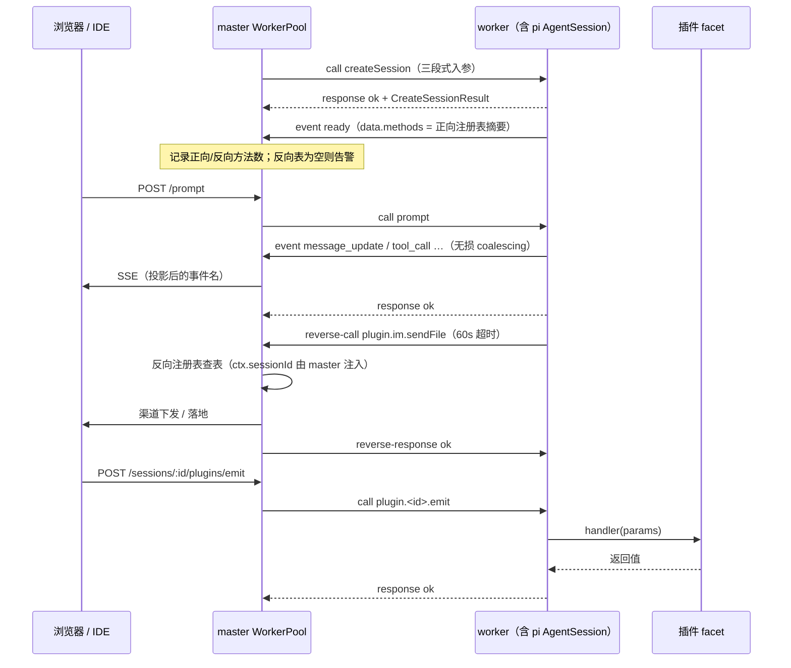

# pi-agent-server ipc

> master ↔ worker 的进程间协议。master 通过 `child_process` IPC 通道跟 worker（每个会话一个进程，内含一个 pi `AgentSession`）通信。
>
> 一条协议、两个方向、一个事件流。**方法层**由两张注册表驱动，**事件层**是单向广播。

## 设计目标

- **代码层透明**：正向方法名与 pi `AgentSession` 一一对应，调用方不需要另学一套词汇
- **零依赖**：不引入 RPC 框架，只走 Node 内建 IPC
- **类型安全**：协议类型在 `packages/ipc-protocol`，两端共用
- **双向 RPC**：worker 内的工具可反向回调宿主动作（下发文件 / 写通知 / 调 server 能力）
- **可扩展**：插件能注册自己的方法，且不可能冒充内置方法

## 三个通道

| 通道 | 方向 | 语义 | 回执 |
|---|---|---|---|
| **正向调用** `call` / `response` | master → worker | 指令：发消息、切模型、压缩上下文… | 有（无超时，`prompt` 可长跑） |
| **反向调用** `reverse-call` / `reverse-response` | worker → master | 宿主 API：下发文件、写通知、调 server 能力 | 有（60s 超时） |
| **事件** `event` | worker → master | pi 原生事件透传 | **无** |

> 判据：**要回执、要顺序 → 用调用；可丢、高频 → 用事件**。事件不带 id，也没有 ack —— 需要确认的插件通信走反向方法，而不是在事件上叠回执。

## 信封

正向与反向**同形**，只差 `kind`：

```typescript
/** 两向共用。kind 是唯一区别。 */
interface CallEnvelope<K extends 'call' | 'reverse-call'> {
  kind: K;
  id: number;
  method: string;
  args: unknown[];
}

/** 两向共用。按 ok 判别，不靠可选字段。 */
type ResponseEnvelope<K extends 'response' | 'reverse-response'> =
  | { kind: K; id: number; ok: true; result: unknown }
  | { kind: K; id: number; ok: false; error: { message: string; stack?: string } };

/** 单向广播。没有 id、没有回执。 */
interface WorkerEvent { kind: 'event'; event: WorkerEventKind; data?: unknown }
```

`CallRequest` 与 `ReverseCallRequest` 都是 `CallEnvelope` 的实例；`method` 在正向侧收窄为 `WorkerMethod` 联合（14 个），反向侧是普通字符串（由 master 注册表决定）。

**为什么同形**：两个方向本来就是"一方问、一方答"的同一件事。分成两套类型必然漂移——曾经反向响应就是 `{ ok: boolean, result?, error? }` 的折叠写法，与正向的判别式联合不一致。同形之后两端的 pending / 响应处理逻辑可以共用一套心智。

**超时**：正向不设超时（`prompt` 可能跑几分钟）；反向 60s —— 反向方法里存在真正的 I/O（`plugin.im.sendFile` 会走渠道上传），30s 会误杀。

**不带版本字段**：master 与 worker 同仓、同版本、同一次启动。跨版本互通不存在，加版本号只会得到永远不会被读取的字段。

## 方法注册表：分发的唯一依据

两端各持一份 `IpcMethodRegistry` 实例：

| 侧 | 表 | 回答的问题 |
|---|---|---|
| **worker** | 正向表 | 谁能处理 master 发来的 `call` |
| **master** | 反向表 | 谁能处理 worker 发来的 `reverse-call` |

条目是**纯数据**（因此可以随握手在进程间传递）：

| 字段 | 取值 | 说明 |
|---|---|---|
| `name` | 完整方法名 | 内置无前缀；插件必须 `plugin.<pluginId>.` |
| `direction` | `forward` / `reverse` | 走哪个方向 |
| `handlerSide` | `worker` / `master` | handler 在哪一侧执行（派生自 `direction`，落成数据便于诊断） |
| `source` | `core` / `plugin:<id>` | **归属**。判断方法属于谁一律查这个字段 |
| `kind` | `mirror` / `platform` / `plugin` | 与 pi 同名 / 平台生命周期 / 插件贡献 |
| `status` | `enabled` / `disabled` / `deprecated` | 插件被禁用时置 `disabled`，条目不删 |
| `description` / `paramsSchema` | 可选 | 诊断面用，分发时不校验 |

### 命名规则

- **内置方法不带前缀**，正向内置方法必须与 pi `AgentSession` 同名同义（平台生命周期的 `createSession` 除外）
- **插件方法强制 `plugin.<pluginId>.<method>`**，注册时校验，不合规直接拒绝并进 `rejected[]`

前缀只做两件事：**防止插件冒充内置方法**、**按来源分组管理**（日志 / 审计 / 禁用）。归属与语义判断一律读 `source` 字段，**不切分字符串**——前缀是准入规则，不是解析手段。

### 错误语义

| 情形 | 返回 |
|---|---|
| 方法未注册 | `unknown method: <name>` |
| 已注册但插件被禁用 | `method disabled: <name>` |
| 已注册但标记废弃 | 正常执行 + 一条 warn 日志 |

两种失败必须可区分：客户端要能判断"这个平台没有这个能力"还是"这个能力被关掉了"。

### 握手与观测

- worker 就绪时发 `ready` 事件，`data.methods` 携带本侧注册表摘要（纯数据，不含 handler）。master 收到后记录"正向 N 个 / 反向 M 个"，反向表为空时告警（说明组合根的注册漏了，此后每次反向调用都会失败）
- `GET /api/runtime/methods` 返回完整方法清单：master 的反向表 + 每个存活 worker 的正向表

## 正向方法（14 个）

13 个镜像 pi `AgentSession`，1 个平台生命周期方法。

| 方法 | 类型 | 说明 |
|---|---|---|
| `prompt` | mirror | 发一条用户消息（可带附件），`args: [text, { streamingBehavior?, attachments? }]` |
| `abort` | mirror | 中断当前运行 |
| `setModel` | mirror | 切 model，`args: [provider, modelId]` |
| `setThinkingLevel` | mirror | 切 thinking level |
| `setTools` | mirror | 覆盖启用工具集 |
| `setSessionName` | mirror | 设置 pi 原生显示名（穿透写 jsonl，见下文标题同步） |
| `compact` | mirror | 压缩上下文 |
| `getContextUsage` | mirror | 读上下文用量 |
| `getSystemPrompt` | mirror | 读系统提示词 |
| `getSessionResources` | mirror | 读会话资源清单 |
| `listAvailableModels` | mirror | 列可用 model |
| `listCommands` | mirror | 列斜杠命令 |
| `dispatchCommand` | mirror | 执行斜杠命令 |
| `createSession` | **platform** | 创建 / 恢复 pi 会话，唯一带平台语义的正向方法 |

`createSession` 是"平台预置方法"，不与镜像方法合并：它返回 `CreateSessionResult`（`piSessionPath` / 实际 model / 实际 thinkingLevel / pi 原生名字），是会话生命周期的起点，而镜像方法是会话运行期的操作。

### `createSession` 入参：三段式

单一对象参数，形状对齐 `sessions` 表：

| 段 | 字段 | 来源 |
|---|---|---|
| ① 会话行对齐 | `sessionId` / `model` / `thinkingLevel` / `config` / `existingSessionPath` | `sessions` 行（新会话时取 agent 创建它的那份配置） |
| ② 平台注入 | `workspacePath` / `capabilityIndex` | 不进表。`workspacePath` 取自 agent（工作目录跟随 agent），`capabilityIndex` 是本次启动时的授权快照 |
| ③ 派生 | `plugins` | **必须**由 ① 的 `config.extensions` 派生 |

两条硬约束：

- **`workspacePath` 是唯一来自 `agents` 表的字段**；其余全部来自会话行。会话是运行时主体，agent 只在建会话那一刻提供初始值
- **`plugins` 不能独立传入**。它由 `config.extensions` 在同一函数内派生，调用方拿不到第二份列表——这样"config 用会话行、插件用 agent"的双源漂移在形状上就不成立（该 bug 曾真实存在：respawn 时 config 走会话行、插件走 agent，改 agent 的 extensions 会漂移已存在会话的插件集合）

`existingSessionPath` 缺省即"全新会话"（没有历史可载入），不需要为跳过位置参数而传 `undefined`。

## 反向方法

worker → master 的宿主动作。全部登记在 master 侧注册表。

| 方法 | 提供者 | args 契约 |
|---|---|---|
| `plugin.im.sendFile` | im 插件 | `[{ filePath, fileName?, caption? }]` |
| `plugin.notifications.post` | notifications 插件 | `[{ title, body, severity? }]` |
| `plugin.admin.invoke` | admin 插件（能力控制面） | `[method, params?]` |

**调用方身份由注册表上下文传入**（handler 的第一个参数是 `sessionId`），不放在 `args` 里——身份不是业务参数，让调用方自带身份等于让它可以撒谎。

`plugin.admin.invoke` 是 server 管理能力的**统一入口**：所有 `callServer` 业务方法都从这一个反向方法过，由 master 控制面完成"解析 → 授权 → 审计"（见 [`capabilities`](pi-agent-server_capabilities.md)）。

## 事件通道

`WorkerEventKind` 共 13 种，按用途分四组：

| 组 | 事件 |
|---|---|
| 生命周期 | `ready` / `agent_start` / `agent_settled` / `agent_end` |
| 消息与工具 | `message_update` / `message_end` / `tool_call` / `tool_result` |
| 重试与队列 | `auto_retry_start` / `auto_retry_end` / `queue_update` |
| 平台内部与插件 | `session_info_changed`（master 内部消费，不进 SSE）/ `plugin_event`（转发为 SSE `plugin.<id>.<name>`） |

事件在 worker 侧做**无损 coalescing**（快照 last-wins + 60ms 节流），有损投影（合并 / 改名 / DTO / 过滤）在 master 的 HTTP 层做。新增事件类型是四处联动：协议类型 → worker 映射（必须在投影之前特判，否则静默丢失）→ master SSE 转发 → 前端事件白名单。

## 插件桥：封装层

插件**不接触裸 IPC**。worker facet 拿到的 `bridge` 就是封装层，它做三件事：

| 职责 | 实现 |
|---|---|
| **拼前缀** | `bridge.registerMethod('emit', h)` → 注册为 `plugin.<本插件 id>.emit` |
| **解前缀** | 分发时剥掉前缀，handler 收到的就是自己注册的名字 |
| **限制可调面** | `bridge.call(method, args)` 只走反向表；正向方法名会得到 `unknown method` |

三个方法的分工：

- `emit(name, data)` —— 上行插件事件，无回执、可丢、高频
- `registerMethod(name, handler)` —— 注册本插件可被调用的方法，有回执、有顺序
- `call(method, args)` —— 调 master 反向方法

平台没有"插件专用通道"这种东西：浏览器投递到插件的能力走 `POST /api/sessions/:id/plugins/emit`，最终落到插件自己注册的 `plugin.<id>.emit`，与 master 主动调走同一张表、同一条分发路径。没有接收者就是 `unknown method`，不是静默成功。

## 通道时序



## 与 pi 自带 RPC 模式的区别

| 维度 | pi `--mode rpc` | 本方案 |
|---|---|---|
| 协议所有权 | pi 的 | 我们的 |
| 能力暴露 | RPC 子集 | 全部（worker 包住 SDK） |
| 协议耦合 | server ↔ pi | master ↔ worker（自控） |
| 升级影响 | pi 改协议 → server 必改 | 只改 worker 实现 |

## 标题同步通道

三组协议字段服务 `sessions.title` 与 pi 原生 display name 的双向同步：

- **正向 `setSessionName`**：pi `AgentSession.setSessionName()` 的透传。它是内存 API 但穿透写文件（内部 append jsonl `session_info` entry 并**同步**发事件，先于本次 call 的 response 到达 master，FIFO 无竞态）；worker 活着时禁止绕过它直接改 jsonl（树簿记依赖内存态）
- **事件 `session_info_changed`**（`data: { name }`）：**master 内部消费**写 `sessions.title`（无 row 即 placeholder → debug 跳过、不缓冲），**不进 SSE 流**（双端 `useSSE` 契约不变）
- **`CreateSessionResult.sessionName`**：`createSession` 带出 pi 侧当前名字，供加载时与 DB title 比对（heal，DB 优先）

命名来源三通道（平台手动改名 / pi TUI / 未来自动命名插件）全部汇入同一事件回流；三种会话状态的行为矩阵见 [`pi-agent-server_session-lifecycle.md`](pi-agent-server_session-lifecycle.md) 的"Session title 双向同步"。

## master 侧入口

业务代码统一通过 `workerPool.call(sessionId, method, args)` 发起正向调用（内部走注册表 + pending map）。`packages/sdk-integration` 里另有 `AgentSessionProxy`——同一协议的另一种封装，镜像 pi `AgentSession` 的方法签名，当前不在 server 主路径上使用。

## 相关文档

- [`pi-agent-server_worker-pool.md`](pi-agent-server_worker-pool.md) —— 进程模型与 `registerService` 注册入口
- [`pi-agent-server_capabilities.md`](pi-agent-server_capabilities.md) —— `plugin.admin.invoke` 的控制面消费方
- [`pi-agent-server_plugins.md`](pi-agent-server_plugins.md) / [`plugins-manual`](pi-agent-server_plugins-manual.md) —— 插件桥（`emit` / `registerMethod` / `call`）
- [`pi-agent-server_session-lifecycle.md`](pi-agent-server_session-lifecycle.md) —— 会话创建、恢复与配置快照
- [`pi-agent-server_overview.md`](pi-agent-server_overview.md) —— 整体定位
