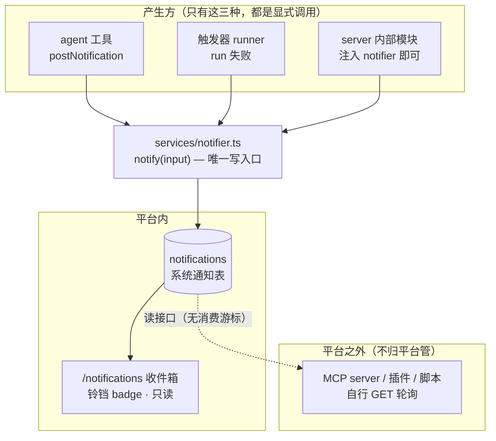
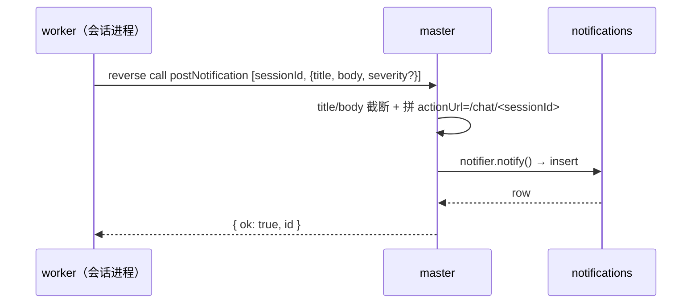

# 系统通知（notifications）

> **独立子系统，不属于触发器。** 它只做一件事：把"平台内部发生的事情"记成一行事实，供用户（和任何客户端）事后看。
> server 内部异常只是**三个调用方之一**；平台不向外投递、不重试、不做 DSL。

对应代码：`apps/pi-agent-server/src/{services/notifier.ts, repos/notification.repo.ts, routes/notifications.ts}`、`workers/session-worker/src/tools.ts`（`postNotification`）、`apps/pi-agent-web/src/{views/notifications/*, composables/useNotifications.ts}`。

---

## 1. 全景



三条硬边界：

| 方向 | 形态 |
|---|---|
| **写** | 只有内部 `notify()`。HTTP 上**没有**创建端点（`POST /api/notifications` → 404） |
| **读** | `GET /api/notifications` + 已读标记，任何客户端都能拉 |
| **外发** | **平台完全不碰**。要推手机 → 平台之外的组件自己消费读接口 |

---

## 2. 产生方

| 来源 | `source` | `sourceId` | `actionUrl`（平台生成） |
|---|---|---|---|
| agent 调 `postNotification` 工具 | `agent` | `sessionId` | `/chat/<sessionId>` |
| server 自身异常（启动失败等） | 自由文本 | 视情况 | 视情况 |

**新模块要发通知**：把 `Notifier` 实例注入进来直接 `notify()` 即可，不需要改表、不需要加枚举——`source` 是普通文本列。`Notifier` 现在是**组合根直接创建**的 server 级依赖（`createNotifier({ notificationRepo })`），不再挂在任何子系统的 runtime 上。

**绝不由 assistant message 派生**：`message_end` / `agent_end` 只说明"说完了"，不说明"该不该打扰人"。agent 要说，就得显式调工具。

---

## 3. 数据模型

| 列 | 类型 | 语义 |
|---|---|---|
| `id` | text | uuid |
| `severity` | `info \| warning \| error` | UI 色条 + 筛选；也是唯一"轻重"表达 |
| `title` / `body` | text | 落库前在 master 侧截断（200 / 4000 字符） |
| `source` / `source_id` | text | 归因，见 §2 |
| `action_url` | text? | 平台生成的站内深链，**不接受调用方传入** |
| `read_at` | int? | `null` = 未读。**只表示"用户看过"** |
| `created_at` | int | 毫秒时间戳，降序索引 |

索引：`idx_notifications_created_at`、`idx_notifications_unread`。

**没有投递字段**（没有 `deliveries` / `delivery_status` / `delivery_attempts`）。历史设计曾把逐渠道结果记在行上，后来整层被砍——见 §7。

---

## 4. 写入口

```ts
// services/notifier.ts
notify({ severity?, title, body, source, sourceId?, actionUrl? }) → NotificationDTO
```

就是一次 `repo.create()`。没有模板、没有 HTTP、没有重试、没有 `silent` 开关（不需要了）。

### 4.1 `postNotification` 工具（agent 侧唯一入口）

- **serverBuiltinTool**：worker 注册 `postNotification` 工具 + master 反向方法 `plugin.notifications.post`，与 `sendFileToUser`（反向 `plugin.im.sendFile`）同款；闸门只有一个 = agent/触发器的 `serverBuiltinTools` 是否含 `postNotification`（**没有** capability allowlist——那是 `callServer` 的授权面）
- 参数面只有 `{ title, body, severity? }`；`sessionId` / `actionUrl` 由 master 按调用方会话填，模型传了也忽略（`additionalProperties: false`）
- 名字是 `postNotification` 而**不是** `sendNotifyToUser`：平台不承诺"送达"，只把一条消息写进通知中心。工具描述照此写，prompt 里也不许暗示外部推送
- 出现在 web 勾选清单（`SERVER_BUILTIN_TOOLS`）里，三处表单（agent 编辑器 / 会话详情 / 模板）都能勾



---

## 5. 读接口

```
GET  /api/notifications?unread=1&severity=error&limit=50   → { items, unreadCount }
POST /api/notifications/:id/read                          → { ok, unreadCount }
POST /api/notifications/read-all                          → { ok, changed, unreadCount }
```

`limit` 夹在 1–200（默认 50），`severity` 非法值忽略。

**没有 `since` / cursor / ack 位点**：`read_at` 是用户态，不是消费位点。外部消费者要持续拉，就自己存"上次看到哪条"并去重——这是它自己的事，平台不为它加参数。

---

## 6. 收件箱 UI

| 位置 | 行为 |
|---|---|
| `/notifications` 页 | 只读列表：severity 色条、筛选 chips（全部/未读/错误/警告）、全部已读、点击已读并跳 `actionUrl`；要回复请进会话 |
| header 铃铛 | 未读数 badge（0 时不渲染），入口到 `/notifications`；路由 `meta.mobileHidden` 避免抽屉里重复 |
| 状态 | 模块级单例 `useNotifications().unreadCount` 共享，30s 轮询 + 路由切换刷新（没引 Pinia） |

配置侧**没有**"通知"二级菜单——没有任何可配置项。

---

## 7. 非目标（都是刻意的）

| 不做 | 理由 |
|---|---|
| **外部投递**（Bark / ntfy / 企业微信 / webhook 模板） | 重试、去重、合并、静音、分组、@人这些"送出去"的语义没有终点，核心那套"5s 超时 + 三占位符"既不是谁的完整需求也追不上。想推手机：MCP server / 插件 / 自己的脚本消费读接口 |
| 消费游标 | 见 §5：`read_at` 属于用户，不属于消费者 |
| 从消息边界自动生成 | 见 §2：该不该打扰人是判断，不是事件 |
| 通知合并 / digest / 分诊 | 语义交给 prompt 与 agent；平台只记事实 |
| 通知→会话的回复通道 | 收件箱单向；回复走 `actionUrl` 进会话 |

历史原因：投递层（`~/.pi/server/notifications.json` + `/api/config/notifications*` 三个端点 + 436 行配置页 + `deliveries` 列）曾实现过一版，之后整体删除，见 changelog `050-notifications-minimal`。

---

## 8. 边界与陷阱

- **severity 只有三级**，没有优先级/标签/分组；要更丰富的分类请写在 `title`/`body` 里
- **`source` 是自由文本**：加新调用方不需要改 schema，但 UI 不按 source 分类展示（只有 severity 与未读）
- **落库即完成**：`notify()` 不等待任何外部结果，调用方拿到行就算成功
- **表结构变更走"改初始建表 + 重建库"**（项目规矩），已存在的库不会自动 drop 旧列——`deliveries` 这类历史列在旧库里留着无害（drizzle 只按 schema 取列）
