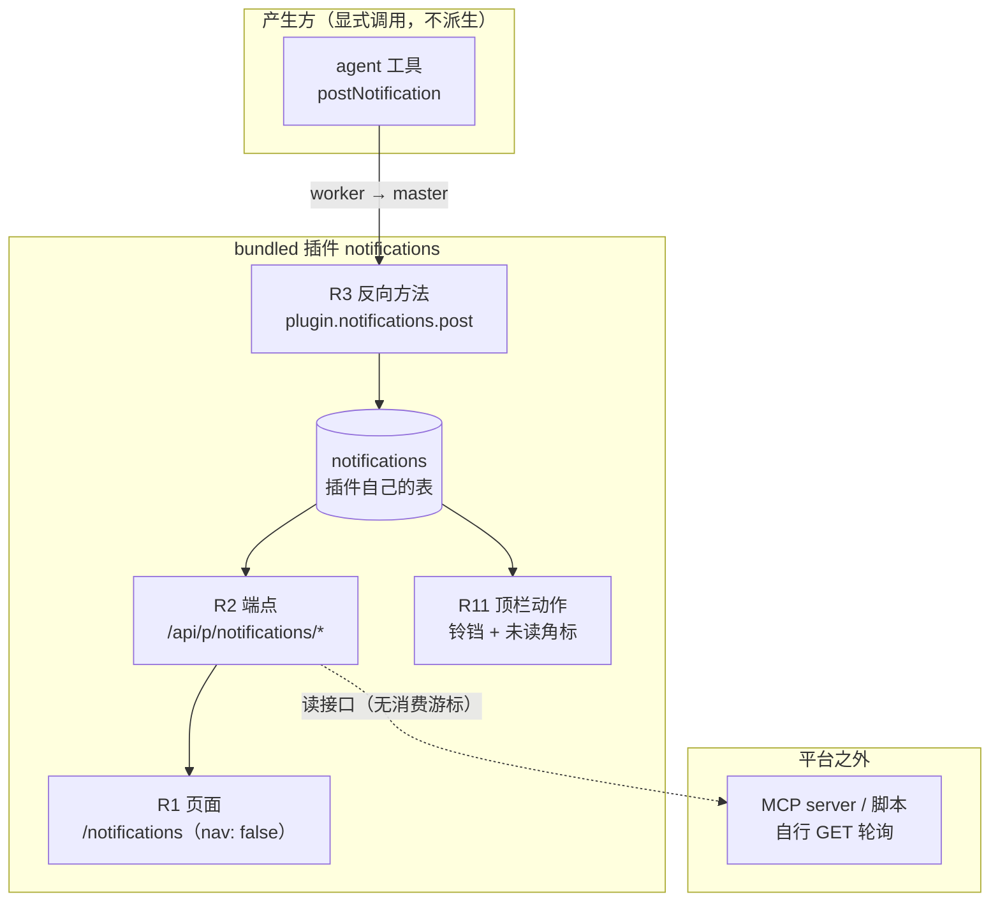
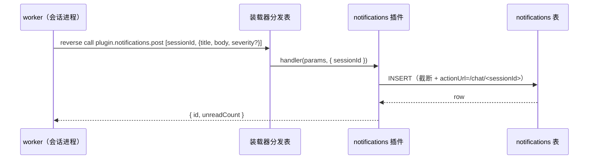

# 系统通知（notifications · bundled 插件）

> **它现在是一个随包插件，不再是入口的一部分。** 归属：`platform/plugins/notifications/`。
> 表、端点、反向方法、顶栏入口、正式页面全在插件里；入口侧不认识"通知"这个概念。
>
> 判据（做减法）：把这个插件 `disable` 之后，平台还能建 agent、开会话、聊完一轮 —— 只是收件箱空了。

职责一句话：把"平台内部发生的事情"记成一行事实，供用户事后看。**不投递、不重试、不合并去重、不对外发 HTTP。**

## 1. 代码位置

| 部件 | 位置 |
|---|---|
| server facet（表 + 端点 + 反向方法） | `plugins/notifications/server/src/index.ts` |
| web：顶栏面板 | `plugins/notifications/web/src/panel.ts` |
| web：正式页面 | `plugins/notifications/web/src/page.ts` |
| 编译产物（gitignored） | `plugins/notifications/{server,web}/*.js`（`pnpm build:plugins`） |
| worker 侧工具 | `plugins/notifications/extension/src/index.ts`（R6；已从 worker 硬编码壳迁走） |

## 2. 全景



三条硬边界没变：

| 方向 | 形态 |
|---|---|
| **写** | 只有反向方法 `plugin.notifications.post`。HTTP 上**没有**创建端点 |
| **读** | `GET /api/p/notifications/` + 已读标记，任何客户端都能拉 |
| **外发** | **平台完全不碰**。要推手机 → 平台之外的组件自己消费读接口 |

## 3. 数据模型

表由插件的 `host.db.migrate('notifications', ddl)` 创建（幂等），并登记进 `plugin_migrations` 台账 ——
`pi-server plugin remove notifications` 会列出"留下的表"，**不自动删**。

| 列 | 类型 | 语义 |
|---|---|---|
| `id` | text | `ntf_<timestamp36><rand>` |
| `severity` | `info \| warning \| error` | UI 色条 + 筛选 |
| `title` / `body` | text | 落库前截断（200 / 4000） |
| `source` / `source_id` | text | 归因（`agent` + sessionId） |
| `action_url` | text? | 平台生成的站内深链 `/chat/<sessionId>`，**不接受调用方传入** |
| `read_at` | int? | `null` = 未读。**只表示"用户看过"**，不是消费位点 |
| `created_at` | int | 毫秒时间戳，降序索引 |

索引：`idx_notifications_created_at`、`idx_notifications_unread`。**没有投递字段**（历史上那层已整块砍掉）。

## 4. 写入口

```js
host.methods.handle('post', (params, ctx) => { /* 截断 + 拼 actionUrl + insert */ })
```

- 调用方是 worker 的 `postNotification` 工具；`sessionId` 来自 `ctx`（分发侧给），模型传不了
- 闸门只有一个：**本插件对该会话是否生效**（`agent.config.plugins` 含 `notifications`）。工具本身由插件的 `extension` facet 注册（`plugins/notifications/extension/src/index.ts`），插件停用 → 工具消失
- 名字是 `postNotification` 而**不是** `sendNotifyToUser`：平台不承诺送达



## 5. 读接口

```
GET  /api/p/notifications/?unread=1&severity=error&limit=50   → { items, unreadCount }
GET  /api/p/notifications/unread-count                        → { count }   ← 顶栏角标专用
POST /api/p/notifications/:id/read                            → { ok, unreadCount }
POST /api/p/notifications/read-all                            → { ok, changed, unreadCount }
```

`limit` 夹在 1–200（默认 50），`severity` 非法值忽略。**没有 `since` / cursor / ack 位点** —— 外部消费者自己存位点去重。

## 6. 两个入口，一份数据

| 入口 | 形状 | 说明 |
|---|---|---|
| 顶栏铃铛（**R11**） | 图标按钮 + 角标 + 点开就地展开面板 | 面板只显示最近 6 条 + 「查看全部通知 →」 |
| 正式页面（**R1**，`nav: false`） | `/notifications` | 不限条数、筛选、全部已读。**不进导航**，从面板跳过来 |

`nav: false` 就是为了避免"导航里一个「通知」+ 顶栏一个铃铛"两个同名入口。角标走
`badge: { endpoint: '/unread-count' }`：宿主每 60s 拉一次，面板关闭时也会刷一次。

## 7. 历史（为什么长这样）

1. **v1 在入口里**：`services/notifier.ts` + `repos/notification.repo.ts` + `routes/notifications.ts` + app.ts 里一段 `registerService`，共 214 行；web 侧还有 353 行 Vue。
2. **v1 曾有投递层**：`notifications.json` 渠道文件、`deliveries` 列、重试/合并/静音，前端一次没渲染过 —— 整层删除（见通知退化为系统通知表那次变更）。
3. **v2 下沉为 bundled 插件**：表、端点、反向方法、UI 全搬进 `platform/plugins/notifications/`；入口侧零残留。迁移后 `grep useNotifications|createNotifier|/api/notifications` 全仓为 0。
4. **v3 工具也归插件**（`scheduler-plugin`）：`postNotification` 从 worker 硬编码壳迁到 `extension` facet；`serverBuiltinTools` 退役，工具是否出现只看插件是否对该会话生效。
