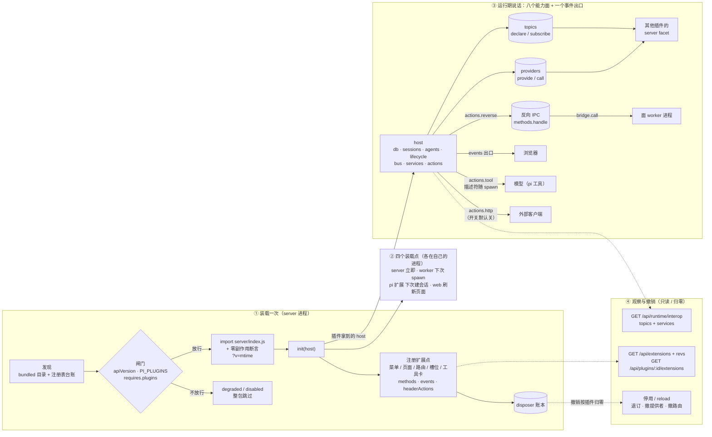

# 插件运行期（v2：代码即行为契约）

> change: `plugin-mechanism-v2`。本文描述**当前**实现；v1 的声明式清单、facet 级开关、精确匹配路由均已删除。

## 一句话

插件是**带 `package.json` 的目录**：目录里的子目录决定"在哪装载"，文件里的 `export default { init }` 决定"装载时做什么"，内核给的 `host` 决定"能做什么"。

三条正交的线：

| 线 | 由什么表达 | 谁读它 |
|---|---|---|
| **装载点**（在哪跑） | 目录存在性：`server/` `worker/` `extension/` `web/` | 装载器 |
| **扩展点**（做什么） | 代码默认导出里调的注册函数 | 内核注册表 |
| **能力面**（能做什么） | 内核注入的 `host` 对象（八个能力面 + 一个事件出口） | 插件 |

facet 级开关（`piServer.facets`）与声明式菜单已删除 —— 它们是"第二套真相"，会与代码漂移。

## 全景图



读法：**① 是"装载一次"**（发现 → 闸门 → import（零副作用断言）→ `init(host)` → 注册 → 记账），**② 是"同一个插件落在几个进程"**（四个装载点各有自己的生效时机），**③ 是"运行期怎么说话"**（八个能力面 → 三张互操作表 → 其它 facet / 模型 / 外部 / 浏览器），**④ 是"怎么观察、怎么收回来"**（三个只读端点 + 按插件归零的撤销）。

三条虚线是"机制保证而不是纪律约定"的那几处：零副作用断言（import 期注册直接拒）、撤销走账本（`disposePlugin` 一起清订阅与提供者）、查询面只读。

## 四个装载点

| 装载点 | 位置 | 生效时机 | 装载者 |
|---|---|---|---|
| ① server | 运行插件的**那个进程**（当前是 server），`server/index.js` | 启用 / reload 后**立即** | `packages/core/src/services/plugin-extensions.ts` |
| ② worker | 会话 worker 进程，`worker/index.js` | 下次 spawn 该会话 | `workers/session-worker/src/session.ts` |
| ③ pi 原生扩展 | 会话 worker 内的 pi 扩展系统，`extension/index.js` | 下次创建会话 | 同上 |
| ④ 浏览器 | SPA，`web/*.js`（`mount(el, host)`） | 浏览器下次加载 / 刷新 | `apps/pi-agent-web/src/plugins/host.ts` |

**平台自身能力走同一条路**：`sendFileToUser` 是 worker 侧的 **inline 插件**（`workers/session-worker/src/inline-plugins.ts`），编译进平台、不经目录发现、不可卸载，但注册动作与目录插件完全一致。判定分界 = **实现方在不在平台代码里**。

原 `callServer`（8 个管理能力）已改为 bundled 插件 `admin` 的**动作**：它的实现方是平台代码，但"平台管理"本身是可停用的能力，所以走插件形态 —— `enabled:false` 之后平台照样能建 agent、开会话、聊完一轮。

## 十一个注册扩展点

| # | 装载点 | 扩展点 | 注册调用 |
|---|---|---|---|
| R1 | server | 页面（**菜单 + 路由一次注册**） | `host.ui.page({ path, label, icon, component })` |
| R2 | server | HTTP 路由（段级模式） | `host.http.route({ method, path, handler })` |
| R3 | server | 反向方法（worker → master） | `host.methods.handle(name, fn)` |
| R4 | server | 表迁移 | `host.db.migrate(name, ddl)` |
| R5 | worker | 正向方法（master/浏览器 → 本插件） | `host.methods.handle(name, fn)` |
| R6 | pi 扩展 | 工具 | `pi.registerTool(def)` |
| R7 | pi 扩展 | 命令 | `pi.registerCommand(...)` |
| R8 | pi 扩展 | 钩子 / 资源注入 | `pi.on(...)` 等 pi 原生面 |
| R9 | 浏览器 | 挂载点 + 组件 | `host.ui.slot({ slot, id, component })` |
| R10 | 浏览器 | 工具卡接管 | `host.ui.toolCard({ tool, mode, entry })` |
| R11 | 浏览器 | 顶栏动作（图标按钮 + 面板） | `host.ui.headerAction({ id, icon, title, component, badge? })` |

定时器**不在清单里**：它没有注册动作，是 `init()` 里自起的资源（平台不管调度、不补跑）。

### 顶栏动作区（R11）

顶栏右侧是**插件可扩展的图标按钮区**（GitHub 右上角那种），平台的架构图 / 主题切换与插件动作共处一排：

- **形状仍是一条**："地址 + 组件" —— 点开后在顶栏下方就地展开面板（不跳页），面板内容 = `web/<component>.js` 的 `mount(el, host)`
- **折叠**：桌面全平铺；紧凑端只留 `INLINE_ON_COMPACT`（当前 1）个插件动作，其余与平台的架构图一起进「更多」菜单。**主题切换始终常驻**（全站开关，藏进二级菜单没人找得到）
- **角标**：`badge: { endpoint: '/unread-count' }` → 宿主每 60s `GET /api/p/<id><endpoint>` 取 `{ count }`，面板关闭时再刷一次。用只读端点而不是回调，因为注册发生在 server 侧，拿不到浏览器里的实时状态
- **面板单实例**：同时只开一个；点空白 / Esc / 再点同一个都关

### UI 只有一种形状

`ui.page` / `slot` / `toolCard` / `headerAction` 都是"**地址 + 组件**"，装载路径完全一致：同源 URL → 动态 `import()` → `mount(el, host)`。差别只在**位置**：整页、页面里的一个坑、顶栏的一个按钮。

`ui.page` 还带一个 `nav?: boolean`（默认 `true`）：`nav: false` = **只登记路由、不占导航项**，用于"入口在别处但需要一个正式页面"——例如顶栏铃铛的面板里放「查看全部」跳到 `/notifications`，这样既不用在导航里再造一个同名入口，也有正式页可分享/刷新。

- 槽位名**分两空间**：
  - **平台空间**（闭合枚举，只有 `chat.rail.right`）：平台自己渲染 chrome，加一个要改平台 UI 并发版
  - **插件空间**（`<pluginId>.<name>`，如 `im.channel.create`）：**由某个插件当宿主**时定义的挂载点，提供方注册。平台只校验形态（前缀是合法 pluginId 形态、且不落在保留命名空间 `chat` / `__core__`），**不校验**前缀插件是否存在
  - 保留命名空间是必要的：不加的话注册 `chat.rail.left` 就能冒充平台挂载点
- **宿主插件自己装载**：插件空间槽位（作用域 `global`）进 `GET /api/extensions` 的 `surfaces`，每项带**服务端生成的 `url`**（`/plugins/<pluginId>/web/<component>.js?v=<rev>`）。消费方直接 `import(url)`，平台不渲染、也不许消费方自己拼路径
- 装载失败必须隔离：一个提供方崩了不能把宿主页打白（宿主 `try/catch` + 区块内错误），卸载时 MUST 调 `mount` 返回的清理函数
- 与内置路由冲突时插件页**不抢**：退回到 `/plugin-page/<pluginId>/<pageId>` 兜底路径
- 条件启用（按会话插件集过滤）只作用于 R9 / R10；R1–R8 是全局的

### 路由是段级模式，不是 glob

`:name` 匹配单段（值进 `request.params`）；`*` 只能作**最后一段**（匹配剩余全部，进 `params['*']`）。分发时**字面量永远优先于模式**（否则"注册顺序决定语义"，作者不可能猜对）。webhook 不需要专用机制：插件拿原始路径自己分发。

## 八个能力面 + 一个事件出口（`host`）

插件访问平台的**唯一**通道 —— 不 import 内核模块，也不拿 `WorkerPool`（暴露 = 插件能杀进程）。

| 面 | 形状 | 说明 |
|---|---|---|
| `sessions` | `call` / `get` / `list` / `status` / `hasRow` / `subscribe` / **`ensure`** / **`systemEvent`** | **`call` 是唯一调用口**：平台方法 `prompt` / `abort` 与插件正向方法同一形状。`sessionId` 永远由调用方给（宿主不提供"选会话"）。`ensure` 是"取/建一个可用会话"，`systemEvent` 是"把非用户消息（信封）交给它" |
| `agents` | `list` / `get` / `update` | 插件维护自己的配置块 |
| `db` | `migrate` / `query` | 读写都开放；每次 query 进审计日志 |
| `lifecycle` | `onSessionCreated` / `onSessionDisposed` / **`runtime()`** | 会话生命周期钩子 + 只读运行态快照（版本/uptime/端口/池统计；**数据不是句柄**） |
| `bus` | **`declare`** / `publish` / **`publishAndWait`** / `subscribe` / **`topics`** | **插件间广播**（0..n）：topic 必须先声明，owner 双向受控，发布方拿到送达/处理状态。**handler 返回值一律丢弃** —— 要业务数据请用 `services` |
| `services` | **`provide`** / `call` / **`list`** | **插件间定向调用**（恰好 1 个提供者）：返回业务数据、错误外抛、无会话上下文。与面 worker 的 `host.methods`（带 `sessionId`、私有）**是两套独立机制** |
| `attachments` | 新增（`upload` / `resolvePath`）：附件存取，不给 store 句柄 |
| `actions` | **`define`** | 一份 handler → 反向 / service / tool / http 四个投影（见下节「动作契约」）。**面向 agent / 别的插件 / 外部的同一个行为只写这一份** |
| `events`（出口，非能力面） | `emit` | 发给**浏览器**（worker → server → SSE）；server 侧调用会 warn，明确告警而不是静默吞掉 |

内核侧（`packages/core/src/host-api.ts`）声明**七个面**：`db` / `sessions` / `agents` / `lifecycle` / `bus` / `services` / `actions`。`web`（资源前缀）归入口的 HTTP 层，`events` 是出口而不是能力，`outbound` 属于注册面（变成 `methods.handle`）。

**`bus` 与 `events` 不要混**：`bus` 是"发给别的插件"，`events` 是"发给浏览器"。命名冲突过一次（原先想直接复用 `events`），最后按方向拆开。

会话面与 agent 面一律返回 `Promise`（宿主机将来可能跨进程），`db` 面保持同步（DB 本来就是本进程的资源）。**除 `db.migrate`（内核 `initDb` 只建内核对象的表）之外，插件自己的表都要自己建。**

## 发布方与订阅方互不相识（广播：`bus`）

```ts
// ① 声明：publisher 型 = 只有我能发，谁都能订阅（广播）；前缀 MUST 是本插件 id
host.bus.declare('webhook.delivery.failed', { declaredBy: 'publisher' });

// ② 发布：拿到送达状态（无订阅者是正常态，不是错误）
const r = host.bus.publish('webhook.delivery.failed', {
  hookId, deliveryId, name, agentId, reason, actionUrl: `/webhooks/${hookId}`,
});
// r = { ok: true, delivered: 1 }；未声明 topic → { ok:false, reason:'unknown-topic' }

// ③ 订阅：可能 pending（发布方还没装载），声明后自动生效
host.bus.subscribe('webhook.delivery.failed', (p) =>
  insert({ title: `Webhook「${p.name}」投递失败`, severity: 'error', source: 'webhook', actionUrl: p.actionUrl }),
);
```

**owner 双向管控**（两条都可机械校验，校验点在 `buildHost(plugin)` 的身份绑定里）：

| `declaredBy` | 谁能发 | 谁能收 |
|---|---|---|
| `publisher` | **只有声明者**（防冒名） | 任何插件（这才是广播） |
| `subscriber` | 任何插件 | **只有声明者**（防抢单） |

推论：广播只属于事件；能力型 topic 恰好一个接收者；多个消费方必须显式成链（例如 notifications 自己发 `notifications.raised`，im 订阅它）。

**handler 返回值被丢弃**（运行时强制，不是文档约定）：`publish` 只回 `{ ok, delivered }`，`publishAndWait` 只回 `{ handled, failed, timedOut }` 且 handler 抛错**不外抛**。要业务数据必须走 `services`。

**三个目录各一张表，互不混入**：

| 注册表 | 内容 | 空态含义 |
|---|---|---|
| extensions store | 菜单 / 页面 / 路由 / 槽位 / 工具卡 | 由 facet 存在性决定 |
| `plugin-bus.ts`（`event-bus.ts`） | topic 声明 + 订阅 | **"契约在、暂时没人听"**（正常） |
| `plugin-services.ts` | service 提供者 | **"没人提供"**（错误） |
| 反向 IPC 表（`worker-pool.ts`） | 面 worker 的私有方法（带 `sessionId`） | 未装载 |

三者只共享**每插件的 disposer 账本**（卸载归零断言不变）。合成一张表必须给每行加 `kind` 分支，而"没人接"与"没人提供"这两种相反的空态无法表达。

诊断面：`GET /api/runtime/interop` → `{ topics, services }`（谁声明、谁在听、末次发布；`/api/plugins/:id/extensions` 附带该插件的切片）。

## 工具与 skill：谁提供，谁决定

**没有逐 agent 的工具白名单了**（`serverBuiltinTools` 已退役）。规则只有一条：

> **插件对该会话生效 → 它带来的工具、命令、钩子、skill 全部注入；不生效 → 全部消失。**

| 提供方 | 例子 | 注入条件 |
|---|---|---|
| 插件的 `extension/` facet（R6） | 纯 worker 内完成的工具（现有插件已无此类） | 插件在 `agent.config.plugins` 里 |
| 插件的 `worker/` facet | 正向方法（agent 工具 → `bridge.call`） | 同上 |
| 插件的 `skills/<name>/SKILL.md` | `scheduler` / `webhook` 的用法说明 | 同上 |
| **inline 插件**（编译进平台） | `sendFileToUser` | 恒注入（不随 `config.plugins`） |
| **动作的 `tool` 面**（平台接管注册） | `admin__*` 8 个、`postNotification`、`publishHtmlView`、`schedule_task`、`manage_webhook` | 插件在 `agent.config.plugins` 里，且动作声明了 `tool` |

`inline` 与目录插件的判定分界是**实现方在不在平台代码里**，但这条只用来判断"要不要目录"；
**能不能停用**是另一个问题 —— 管理动作的实现方是平台代码，却做成了 `admin` 插件，因为
"平台管理"是可停用的能力。真正恒注入的只剩 `sendFileToUser`（网关侧的传输原语）。

### 动作契约：一份 handler，四个独立投影

`host.actions.define({ '<action>': { params, handler, reverse, scope, service, tool, http } })` 一次声明
最多产生四类产物，互相独立：

| 字段 | 产物 | 谁会看到 | 缺省 |
|---|---|---|---|
| `reverse` | 反向方法 `<id>.<action>` | 自己插件的 worker（自动注册的工具走这条） | **`true`** |
| `scope` | 只约束 `reverse` 的来源（`own` 只有 owner / `public` 谁都能调） | — | `'own'` |
| `service` | `host.services` 里的同名 service | 别的插件的 server facet | `false` |
| `tool` | pi 工具（描述符随 spawn 下发，worker 自动 `registerTool`） | 模型 | `null` |
| `http` | `POST /api/p/<id>/<path>`（精确路径，body = params） | 外部客户端 | `null`（全局开关默认关） |

默认值判据：**漏了会静默坏的面默认开（`reverse`），漏了会明确报错的面默认关（其余三个）**。
约束只有两条：`tool` 存在 ⇒ `reverse !== false`（工具在 worker 跑）；`http` **不依赖**
`reverse`（主进程直调 handler）。

三种旧机制表达不了的组合，现在能写：`{ reverse:false, service:true }`（只给别的 server）、
`{ scope:'own', service:true }`（别的 server 能、别的 worker 不能）、`{ scope:'own', tool:{…} }`（只给模型）。

工具名缺省 `<id>__<action 点→下划线>`，`exposure` 缺省 `deferred`（零上下文成本，靠 `tool_search`
激活）；命名的唯一性由平台在 spawn 时校验，冲突者**不注册 + warn**（pi 自己的注册表是静默先到先得）。

### 插件自带的 skill：数据目录，不是 facet

约定 `<plugin-dir>/skills/<name>/SKILL.md`：

- 装载器扫出目录 → `RuntimePluginSpec.skillPaths` → worker 并入 `additionalSkillPaths`
- 走 pi 的 `temporary` 豁免：用户 `skills` 白名单**既不能杀它，也不能当开关**
- 不参与 `build:plugins` 编译、不进 `PLUGIN_FACET_NAMES`（它是数据，不是装载点）
- `plugin check` 校验：有 `skills/` 就必须每个子目录有合法 frontmatter 的 `SKILL.md`

### 逐 agent 的开关只有一个

`AgentConfig.plugins`（启用列表）是**会话内能力**的唯一开关：

```
（插件 active）∧（在 agent.config.plugins 里）∧（requiresPlugins 的 pi 扩展名都装了且在该 agent 的 extensions 里）
  → ResolvedPlugin.enabled = true
     → extensionPath / workerPath / skillPaths 下发 worker
```

关掉之后：`extension` facet 不装载（工具消失）、`worker` facet 不装载、`skills/` 不注入。
**关不掉的部分**：`server` facet（HTTP 路由、调度器 timer）与 `web` facet（页面、菜单）是进程级全局资源 —— 它们本来就不属于"某个 agent 的会话"。

## 平台承诺的主题变量

插件 web 面拿到的 `el` 的祖先链上一定有平台 CSS 变量（暗色自动切换）。清单是**可枚举、可校验**的：`packages/core/src/plugins/constants.ts` 的 `PLATFORM_THEME_VARS`。

为什么专门立一条：变量名猜错时 `var(--x, #fff)` **不报错**，静默走 fallback —— 表现为"暗色下这一块永远白底"。真实案例：scheduler 的第一版用了 `--bg-elevated` / `--text-muted` / `--bg-hover`，三个都不存在。

`plugin check` 会扫插件 web 产物里的 `var(--name)`，不在清单里给 warning（`theme-var-unknown`）。

## 生命周期

```
装载：
  import(entry?v=<mtime>.<n>)          ← 破 ESM 缓存
  ↓ 断言注册表增量为 0                  ← 顶层零副作用（硬要求，机械校验）
  取默认导出的 { init, dispose? }
  ↓ init(host)                         ← 所有注册只能发生在这里
  菜单引用校验 / 反向方法 flush

卸载（reload / disable / 进程退出）：
  dispose?.()                          ← 可选，平台不等待/不重试/不校验结果
  ↓ 跑该插件的 disposer 账本（倒序）
  ↓ 断言账本归零（非零 → 记 error 并硬重置）
```

**每个注册/订阅都返回 disposer**，装载器按插件 id 记账。`reload` 就是"卸载 → 重新装载"，所以不需要重启 server：

```
pi-server plugin reload     # POST /api/extensions/reload
```

生效边界写在表里（见「四个装载点」）：server facet 立即、worker/pi 扩展等下次 spawn、浏览器刷新。

**浏览器侧是同一件事的另一半**：ES module 按 **URL** 缓存，HTTP 的 `cache-control: no-cache`
只管网络层 —— 同一个 URL 再 `import()` 拿到的仍是内存里那个旧模块。所以两个扩展点查询接口
（`GET /api/extensions`、`GET /api/sessions/:id/extensions`）都附 `revs`：

```jsonc
{ "revs": { "html-showcase": "mwp78590-dim" } }   // = web/ 目录内容的最大 mtime + 总字节数（1s 缓存）
```

前端把它拼成 `/plugins/<id>/web/<entry>.js?v=<rev>`。于是 `plugin reload`、重装、甚至直接改
`web/` 下的文件之后，下一次挂载拿到的必定是新模块 —— 不需要手动清缓存，**插件作者零操作**。

**不做目录监听**：插件**代码**变化不会被 registry 的文件监听捕获，用上面的命令手动触发。

## 两个目录：bundled 与用户插件

| 来源 | 位置 | 进 `registry.json`？ | 卸载方式 |
|---|---|---|---|
| bundled | `<安装根>/dist/server/plugins`（dev：`platform/plugins`） | ❌ 目录存在即生效 | **墓碑**（`removed: [{ id, removedAt }]`） |
| 用户 | `~/.pi/server/plugins`（dev：`platform/.dev-data/plugins`） | ✅ 只有这里登记 | 删条目（`--purge` 才删目录） |

`registry.json` 收窄成三行一件事：

```json
{ "version": 2, "plugins": [{ "id": "...", "dir": "...", "enabled": true }], "removed": [{ "id": "...", "removedAt": "..." }] }
```

版本 / 描述 / facet 声明一律从 `package.json` 与目录推导 —— 记在台账里就会过期。v1 结构读入时在内存里迁移，多余字段直接丢。

**卸载保留数据**：`plugin remove` 读 `plugin_migrations` 台账（`db.migrate` 时记 `(plugin_id, name)`），列出"留下的表"，**平台不自动删表**（不可逆且可能含真实数据）。

**dev 必须隔离**：`pnpm dev:server` 把插件目录 pin 到 `platform/.dev-data/plugins`。理由是 registry 带 `fs.watch` —— 共用一份文件时，你在 dev 停用一个插件，已安装实例会跟着重载（api 配置 / `mcp.json` / agents 目录没有监听与写回，不需要 pin）。

## 装载器实现要点（`services/plugin-extensions.ts`）

1. **零副作用断言**：`import()` 之后、`init()` 之前比较注册总数。捕获的是真实故障模式 —— 插件把 `host` 偷存到 `globalThis`，下次 reload 时顶层就能注册。
2. **cache bust**：`import('...?v=<mtimeMs>.<counter>')`。相对 import 按入口目录解析，不受 query 影响；counter 兜底同一毫秒内连续 reload。
3. **账本**：注册函数返回 disposer 并入库；卸载时倒序执行，再断言归零。
4. **无效注册一律进 `rejected`**（含原因与 `kind`），绝不静默丢弃；`registerError` 记录 init 抛错/超时。
5. **反向方法整块替换**：`WorkerPool.registerService` 先 `unregisterBySource` 再登记 —— 否则 reload 会撞 `name already registered`。

## 查询面

| 端点 | 内容 |
|---|---|
| `GET /api/plugins` | 静态事实（含 `source: bundled\|user`、状态、facet 探测结果） |
| `GET /api/plugins/:id` | 单插件详情（入口探测 / 依赖 / 关联台账条目） |
| `GET /api/plugins/:id/extensions` | 该插件的全部运行期注册（含 `rejected`）+ **`interop` 切片**（该插件声明/订阅的 topic、提供的 service） |
| `GET /api/extensions` | 全局：`pages`（**已摊平菜单字段**）+ 兼容用的 `menus` + **`surfaces`**（插件空间槽位，每项带 `url`）+ **`revs`**（每个插件 `web/` 的 mtime 版本串） |
| `GET /api/sessions/:id/extensions` | 会话级：`surfaces`（**平台空间**槽位）/ 工具卡（按该会话插件集过滤） |
| `POST /api/extensions/reload` | 重装插件运行期（`plugin reload`）；**dev 实例要打自己的端口**，CLI 的 `plugin reload` 默认找打包实例 |
| **`GET /api/runtime/interop`** | **插件互操作全表**：`topics[]`（topic / owner / declaredBy / 订阅数 / pending 数 / 末次发布）+ `services[]`（name / owner） |
| `GET /api/p/<id>/*` | 插件 HTTP 端点（唯一分发器） |
| `GET /plugins/<id>/web/*` | 插件 web 资源（按**快照**解析目录，bundled 也覆盖） |

## 作者契约（要点）

- 每个 facet 文件 `export default { init(host), dispose?() } satisfies PluginDefinition`（纯对象；**顶层零副作用**）
- `package.json` 只留 `piServer.apiVersion` 与 `requires.plugins`：装载器要**不执行插件代码**就判掉不兼容版本 —— 版本号若在代码里，读它就得先 `import()`，那一刻顶层已经跑完了
- 类型是 **vendored 文件**（`plugin add` / `plugin check` 写进 `<插件>/types/plugin-types/`），不走 `peerDependencies`（`plugin-types` 是 private 包，npm 解析必然失败）
- 产物：原生 ESM、web 产物**无裸说明符 / 无 node 内建 / 非 CJS**、`mount(el, host)` 必须导出
  - `web/**` 是**编译产物目录**（递归受 `plugin check` 校验）；源码放插件根的 `web-src/` 子项目，产物写回 `web/`
  - 需要 npm 依赖时：作者自带构建（esbuild / vite / rollup），bundled 插件由 `build:plugins` 编，本机插件 `build:plugins:local`
  - 平台**不提供 import map**（那会把第三方库版本塞进平台契约）
- 机械校验：`pi-server plugin check <dir>`（入口存在 / ESM / 说明符 / web 产物），`plugin add` 自动调用

## 可执行验收

```bash
pnpm verify:plugins     # 进程内无 HTTP：装载 / 拒绝 / 分发 / 热加载 / 账本 / inline 工具白名单
pnpm verify:sdk         # 内核脱离入口独立运行
pnpm pack:cli           # 含 check-packaged：随包插件与 web 产物断言
```

`verify:plugins` 的六组断言就是本文的六条承诺：注册齐 · 拒绝可见 · 路由分发 · 热加载真生效 · 账本归零 · 顶层零副作用（外加 inline 工具的白名单语义）。

## 待决项

- **server 侧 `events`**：插件主动推 UI 本期未做。将来若需要，可能走"插件自己的 HTTP 路由 + SSE"，而不是新增能力面
- **`bus` / `services` 只有进程内**：worker ↔ master 的事件不走它们（那是 `events` + SSE）；没有持久化/重放；worker facet 也没有 `bus`（会话事实走 `sessions.subscribe`）
- **插件目录监听**：本期靠 `plugin reload` 手动触发
- **`db.query` 全开放**：插件完全可信，已知可 `DROP TABLE`。缓解是审计日志；DDL 拦截留后续开关
- **bundled 改名/替换**：旧 id 的墓碑不做特殊处理（新 id 正常出现）
- **动作 `tool` 的卡片渲染**：`expose.tool.renderer`（toolCard 随描述符注册）预留，本期未做
- **`admin` 的只读状态页**：动作已全绿，`web/` 页面还没做（先用 curl / 模型调用）
