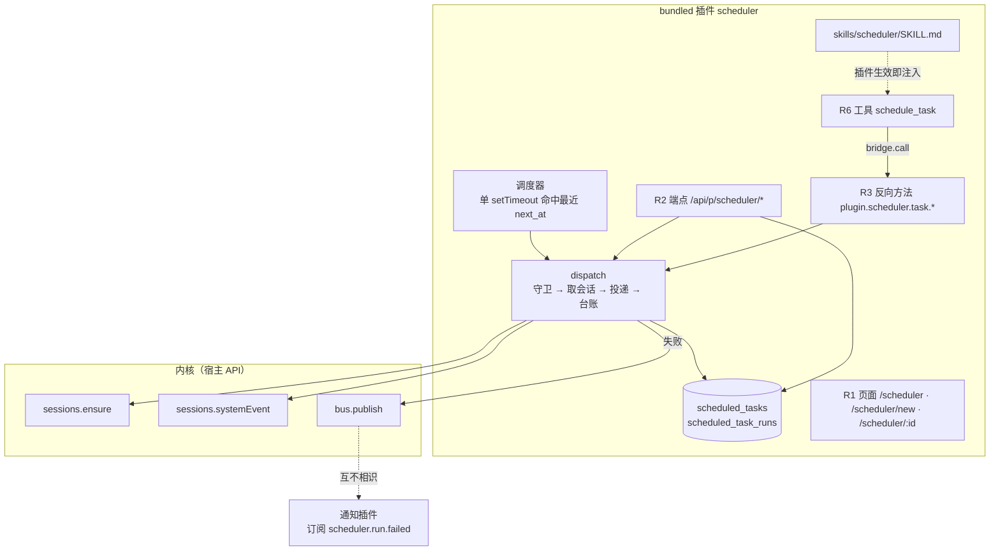

# 定时任务（scheduler · bundled 插件）

> **它是插件，不是内核子系统。** 归属：`platform/plugins/scheduler/`。
> 判据：把它 `enabled:false` / 从某个 agent 的启用列表里去掉之后，平台照常建 agent、开会话、聊完一轮 —— 只是没人再按时间叫 agent 干活。
>
> 旧触发器子系统（`services/trigger/*` + `routes/triggers.ts` + `views/triggers/*`，约 2600 行）在 `event-projection-and-core-sdk` 里整体删除，这份文档描述的是**重做后的形态**。

## 0. 名字与边界

| 概念 | 定名 | 说明 |
|---|---|---|
| 插件 | `scheduler` | 目录、`plugin.scheduler.*` 方法前缀、`/api/p/scheduler/*` 端点 |
| UI | 定时任务 / Scheduled Tasks | 导航项「定时任务」，icon `automation`，order 15 |
| 能力 | `cron` + `once` | **只有时间驱动**。webhook / 外部事件触发不属于它（另立插件） |

**`trigger` 这个词被有意弃用**：它的含义是"任何事件引起的动作"，而 webhook 才是它的典型代表。删掉 webhook 之后只剩时间驱动，于是 UI 与表名都改成 `scheduler` / `scheduled_tasks`。

## 1. 全景



三条边界：

| 层 | 可以做 | 不可以做 |
|---|---|---|
| 调度器 / 端点 / 工具 | 守卫、抢占 slot、读任务行、组事件参数 | 拼信封文本（归内核）、等 agent 跑完、判断 agent 内部成败 |
| `dispatch` | 取会话、投递、写 run、收敛 `max_runs` | 按 source 分支（没有 source 概念了）、写通知表 |
| 内核 `sessions.*` | 建/取会话、构造并投递信封 | 认识"定时任务"这个概念 |

## 2. 运行状态语义：**送到即成功**

run 的 `status` 只回答一个问题：**这条消息有没有送进 agent**。

| status | 含义 |
|---|---|
| `delivered` | `prompt` 被会话接受（IPC 返回成功）→ 成功 |
| `skipped` | 守卫拦下（`overlap` / `disabled`），没送 |
| `missed` | 进程停机期间跨过的 slot，收敛成一条记录，没送 |
| `failed` | 没送到（agent 不存在 / 建会话失败 / 绑定目标失效 / prompt 抛错） |

- 定时任务**不等待** agent 跑完，也不订阅会话事件判断成败
- agent 内部任务的成败、要不要通知、通知给谁 → **由 agent 自己的定义决定**（它自己的 prompt / 工具）。scheduler 只在自己的 run `failed` 时发事件

所以 scheduler 里没有"运行中"状态机，也不会因为 agent 跑了 40 分钟就把 run 挂成失败。

## 3. 数据模型

表由插件的 `host.db.migrate('scheduler', ddl)` 创建（幂等），并登记进 `plugin_migrations` 台账 ——
`pi-server plugin remove scheduler` 只列出"留下的表"，**不自动删**。

```sql
scheduled_tasks(
  id, agent_id, name, prompt,
  schedule_kind CHECK IN ('cron','once'),
  cron_expr, timezone,        -- cron 时必填
  at,                         -- once 时必填（ms）
  session_mode CHECK IN ('new','reuse'), session_id,
  enabled, next_at, max_runs, runs_count, last_fired_at,
  created_at, updated_at
)
scheduled_task_runs(
  id, task_id,
  status CHECK IN ('delivered','skipped','missed','failed'),
  reason, triggered_by CHECK IN ('schedule','manual','plugin'),
  session_id, started_at, finished_at, created_at
)
```

索引：`(enabled, next_at)`（调度器只扫它）、`(agent_id)`、`(task_id, started_at)`、`(finished_at)`（overlap / 僵尸扫描）。

`next_at` 单独成列的理由与旧版一致：调度器一次 `SELECT … WHERE enabled=1 AND next_at<=now` 就够，不需要每 tick 重算所有表达式。

## 4. 会话模式与绑定三态

| 模式 | 行为 |
|---|---|
| `new` | 每次触发新建会话（`sessions.ensure({ agentId })` → `created: true`） |
| `reuse` | 复用绑定会话；idle 被回收后由 `ensure` 懒恢复 |

`reuse` 下 `session_id` 三态：有值 = 已绑定；空 = 未绑定（首次触发创建并回填）；`new` 模式下提交 `sessionId` **直接 400**（不静默丢弃）。

投递前会**再校验一次**绑定目标 —— `sessions.ensure` 对陌生 id 会抛错，所以"会话被删 / 换了 agent"会变成一条 `failed` run，而不是静默写到别处。

## 5. 不变量

| 不变量 | 实现 |
|---|---|
| **抢占唯一** | `UPDATE … SET next_at=? WHERE id=? AND next_at IS ?`；影响 0 行 = 别人先推进了，静默跳过该 slot |
| **overlap** | 30 分钟窗口内存在 `finished_at IS NULL` 的 run → `skipped/overlap`，不建会话 |
| **停机错过不补跑** | 启动 `catchUpMissed()`：各写一条 `missed`（reason 含次数），`next_at` 推进到第一个未来 slot；`once` 顺便停用 |
| **僵尸 run** | 启动 `finalizeStaleRuns()`：`finished_at IS NULL` → `failed/stale`，否则 overlap 会永久卡死该任务 |
| **max_runs 收敛** | 达标即 `enabled=0, next_at=null`；`once` 创建时把 `max_runs` 钉成 1 |
| **启用重算** | `PATCH enabled:true` 按 now 重算 `next_at`（否则过期 slot 会在启用瞬间补跑）；`runs_count >= max_runs` 时拒绝（409） |
| **停用即静默** | 调度器跳过；手动运行记 `skipped/disabled` |
| **cron 解析** | 自研 5 段（分 时 日 月 周）+ IANA 时区 + DST 二次校正；最小间隔 **5 分钟**；表达式语法与最小间隔在**创建时**校验（不留到第一次调度才炸） |
| **时区** | 任务级 `timezone`（IANA），必须显式给；展示与计算都用它 |

## 6. 投递：信封归内核

插件**不拼** `<system-event>` 文本：

```ts
await host.sessions.systemEvent({
  sessionId,
  kind: 'trigger',
  source: 'cron' | 'once',
  name: task.name,
  run: runId,
  instruction: task.prompt,
});
```

文本由内核 `buildSystemEnvelope()` 唯一构造（见 [core-sdk](pi-agent-server_core-sdk.md)）。返回即"送到"，不等 agent。

模型侧看到的是 `role:"user"` + 信封文本；`SYSTEM_EVENT_PROMPT_NOTICE` 由 worker 恒注入，说明"以 `<system-event` 开头的消息来自平台"。

## 7. 两个入口，一份数据

| 入口 | 形状 | 说明 |
|---|---|---|
| 导航「定时任务」`/scheduler`（R1） | 单表：名称 / agent / 计划 / 下次 / 上次 / runs / 状态 + 行内 ▶ ✎ 🗑 | 不做行内展开，runs 在详情页 |
| 详情 `/scheduler/:id` | 「计划」二选一（一次性 / cron + 时区 + 下次预览）、会话模式、prompt、max_runs；右栏最近 50 条 runs | runs 颜色：delivered 绿 / skipped 灰 / missed 橙 / failed 红 |

`/scheduler/new` 与 `/scheduler/:id` 都是 `nav: false`（只登记路由，不占导航项）。

## 8. 归属：工具、skill、能力

**这是本子系统与旧版最大的结构差别。**

| 能力 | 旧版 | 现在 |
|---|---|---|
| agent 自助建任务 | capability `trigger.create/update/delete/run`（`serverBuiltinTools` 勾 `callServer` + `capabilities` allowlist 双闸） | 插件的 `schedule_task` 工具（R6）→ `bridge.call('plugin.scheduler.task.*')` → R3 反向方法 |
| 使用说明 | `pi-trigger-usage` 平台 skill，要在 agent 的 `serverBuiltinSkills` 里勾 | 插件的 `skills/scheduler/SKILL.md`，**插件对该会话生效就自动注入**（不占 agent 配置项） |
| 全局开关 | `PI_TRIGGERS_DISABLED=1` 环境变量 | 插件台账 `enabled:false`；逐 agent 关闭用 `agent.config.plugins` |

`agent.config.plugins` 不含 `scheduler` 时：`extension` facet 不装载 → **`schedule_task` 工具不存在**、SKILL.md 不注入；但插件的 server facet（路由 + 调度器 timer）仍是进程级全局资源，`/scheduler` 页面照常可用（人工仍可给别的 agent 配任务）。

## 9. 已知边界

- **不做外部事件触发**（webhook 属另一个插件）。旧版的 `triggerSources.register()` 扩展点随之取消：插件不能扩展插件，"外部事件 → 跑一轮"的正确形态是**调用方插件**（自己接路由、自己决定何时调 `sessions.ensure` + `systemEvent`）
- **不做重试 / 补跑 / 通知合并**：失败只记一次，错过只记 `missed`
- **不等 agent 完成**，所以也没有"任务超时"这个概念
- 秒级精度 / 小于 5 分钟的周期不支持（明确拒绝，不静默近似）
- 会话归因靠 `[任务名]` 标题前缀与 `session_id` 回填，`sessions` 表无 `creator` / `origin` 列
