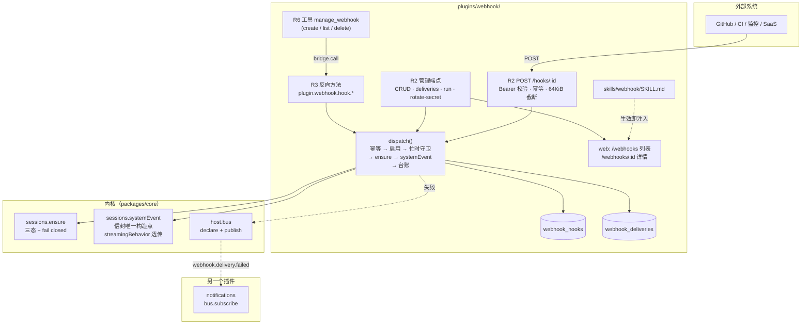

# Webhook（bundled 插件）

> 外部系统 `POST` 一个请求 → agent 在会话里跑一轮。表、端点、工具、页面全在插件里；入口侧不认识"外部事件"这个概念。

## 定位：哑端点

平台**只做三件事**：验 secret、把 body 原样交给会话、记一条投递台账。

- 不做过滤、不做解析、不做路由 —— 那些逻辑属于外部系统（它知道自己发了什么）
- 不做模板插值（`{{payload.x}}`）：一旦支持，平台就从"哑端点"变成"事件处理引擎"，得处理缺字段、类型转换、注入转义
- 不重试、不补投：失败就是失败，外部系统按 `Idempotency-Key` 重投
- `delivery.status` 只表示**消息有没有送进 agent**（`delivered` / `skipped` / `failed`），agent 干得怎么样不归它管

与[定时任务](pi-agent-server_scheduled-tasks.md)的分工只有一句话：**时间驱动用 scheduler，事件驱动用 webhook**，两者互不认识（各自维护表与投递路径，共享的只有内核的 `sessions.ensure` / `systemEvent` 与 `host.bus`）。

## 全景



## 入口：一条插件路由，不加内核别名

```
POST /api/p/webhook/hooks/:id
Authorization: Bearer <secret>
Idempotency-Key: <可选>
<body>
```

| 响应 | 含义 |
|---|---|
| `202 { status: 'delivered', deliveryId, sessionId }` | 消息已进 agent（**不等它跑完**） |
| `200 { status: 'duplicate' }` | 同 hook + 同 `Idempotency-Key` 24h 内已投递过 |
| `409 { status: 'skipped' \| 'failed', reason }` | 收到了但没执行（停用 / 忙 / 会话失效 / prompt 抛错） |
| `401 { error: 'unauthorized' }` | secret 缺失或不匹配（**不记台账**） |
| `404 { error: 'not found' }` | hook 不存在（防枚举：不区分"存在但无权"） |

**投递会阻塞到 worker 就绪**：`new` 模式 + 冷启动时，`ensure` 要 spawn 一个 worker（干净机器实测 ~15 秒），HTTP 请求会等这么久才返回 `202`。外部系统应把超时设到 30 秒以上，并用 `Idempotency-Key` 兜住重试。

**为什么不加 `/hooks/:id` 内核别名**：插件 HTTP 只能挂在 `/api/p/<pluginId>/` 下。一旦内核允许插件声明顶层路径，前缀隔离（插件无法注册别人的路径）就失效了。URL 长一点是可接受代价 —— 外部系统只配一次。

页面用 `location.origin` 补全完整 URL；反代/内网部署时用户自己替换前缀（平台不知道自己的公网地址）。

## 鉴权：per-hook secret，明文存库明文展示

- `webhook_hooks.secret` = `randomBytes(24).toString('base64url')`（32 字符）
- 比较用**常量时间近似**（长度先比 + 逐字符异或，不提前返回）—— 不用 `crypto.timingSafeEqual`（长度不等会抛错，把"探测长度"变成异常路径而不是统一 401）
- **页面明文展示**，不做 mask、不做"只显示一次"：这是单用户自托管平台，能打开 `/webhooks` 的人本来就能改 agent、读全部会话历史。藏起来只增加"我忘了，重置一下"的成本，而重置会立刻切断外部系统
- 可以重置（`POST /hooks/:id/rotate-secret`），旧 secret 立即失效

**边界**：secret 只证明"谁能调这条 URL"，它**不保护 payload** —— body 明文进 `<_data_>`，模型会看到。不要把秘密放进 body。

## 幂等：只认显式头

同一 hook + 同一 `Idempotency-Key` 在 **24 小时**内只执行一次，重复请求返回 `200 duplicate` **且不建台账行**（判定在建行之前）。

**"已执行"包含"正在执行"**：`finished_at IS NULL` 且未超过 10 分钟的投递同样占坑。这条是容器回归测出来的 —— `new` 模式首次投递要等 worker 冷启动（干净机器实测 ~15 秒），期间行还没 `delivered`，外部系统超时重试会**双双执行**。被跳过（`skipped`）与失败的不占坑（本来就该允许重投）。

不用 body hash 自动去重：内容相同 ≠ 事件相同（"磁盘仍占 91%" 连发两次是两个真实观测）。外部系统重投是常态（超时重试、at-least-once 队列），显式头是唯一可信信号。

## body：有上限，且不得影响投递目标

- 上限 **64 KiB**；超出按字节截断（UTF-8 边界可能切出替换字符，可接受），`<data>` 标 `truncated: true`，台账 `payload_bytes` 记**原始**字节数，响应带 `truncated` + `payloadBytes`
- 能 JSON 解析就进 `<data format="json">`，否则原文
- **`<data>` 形状恒定**：`{ payload }`（+ 有 header 时 `_meta: { ip, userAgent }`）。不按"有没有 header"变形 —— 同一个 hook 的两次调用让模型看到两种 JSON 是最糟的不确定性
- **body 无法影响 target**：`agentId` / `sessionId` / 指令全来自 hook 行；body 里塞 `agentId` 只会作为 data 的一部分被模型看到

## 会话绑定：三态，与定时任务同款

| `sessionMode` | 行为 |
|---|---|
| `new`（默认） | 每个事件新建会话；传了 `sessionId` 直接 400（不静默丢弃） |
| `reuse` + 无绑定 | 首次投递创建会话并**回填** `session_id`，此后固定复用 |
| `reuse` + 有绑定 | 复用；绑定目标被删或换了 agent → 本次投递 `failed`（**绝不**静默写到别处） |

注意**占位会话**（还没跑过任何一轮，**没有 DB 行**）可以绑上，但投递会以 `session not found (deleted?)` 失败 —— 占位会话要先跑过一轮落行，绑定才有意义。

## 忙时策略：配置项，内核只透传

pi 的 `prompt` 在 agent 正在流式输出时**必须**给 `streamingBehavior`，否则直接报错。webhook 不能像定时任务那样"跳过这次"（事件是一次性的，丢了就没了），所以把策略做成 hook 的字段：

| `busyPolicy` | 行为 |
|---|---|
| `followUp`（默认） | 排队，当前轮结束后处理 —— 不丢，但会积压 |
| `steer` | 插队到当前轮之后的下一次模型调用 —— 会打断 agent 手头的事，只用于告警 |
| `skip` | `sessions.status() === 'running'` → 记 `skipped/busy`，**不投递** |

**已知 TOCTOU**：`ensure` 到 `agent_start` 之间有 ~1 秒窗口，此时 `status()` 还是 `idle`，`skip` 会漏判。语义上可接受（"忙就算了"），但要知道它不是硬保证。

内核侧只多了一个可选参数：

```ts
sessions.systemEvent({ sessionId, kind, source, name, run, instruction, data, streamingBehavior })
```

`streamingBehavior` 原样转给 pi。不传 = 现状（报错），所以既有调用方零影响。判定在 `services/system-envelope.ts` 的 `systemEventPromptOptions()`，`verify:sdk` 断言了三个分支。

## 数据模型

```sql
CREATE TABLE webhook_hooks (
  id TEXT PRIMARY KEY, agent_id TEXT NOT NULL, name TEXT NOT NULL, prompt TEXT NOT NULL,
  session_mode TEXT NOT NULL CHECK (session_mode IN ('new','reuse')), session_id TEXT,
  busy_policy TEXT NOT NULL DEFAULT 'followUp' CHECK (busy_policy IN ('followUp','steer','skip')),
  secret TEXT NOT NULL, enabled INTEGER NOT NULL DEFAULT 1,
  deliveries_count INTEGER NOT NULL DEFAULT 0, last_delivered_at INTEGER,
  created_at INTEGER NOT NULL, updated_at INTEGER NOT NULL
);

CREATE TABLE webhook_deliveries (
  id TEXT PRIMARY KEY, hook_id TEXT NOT NULL,
  status TEXT NOT NULL CHECK (status IN ('delivered','skipped','failed')),
  reason TEXT, triggered_by TEXT NOT NULL CHECK (triggered_by IN ('http','manual','plugin')),
  idempotency_key TEXT, payload_bytes INTEGER, session_id TEXT,
  received_at INTEGER NOT NULL, finished_at INTEGER, created_at INTEGER NOT NULL
);
```

- 表由插件 `host.db.migrate` 自建并登记台账；**删除 hook 级联删投递记录**（外部事件的过程数据不构成跨 hook 的审计）
- `deliveries_count` 只在 `delivered` 时 +1（跳过与失败不计数）
- 启动时把 `finished_at IS NULL` 且超过 10 分钟的投递收尾为 `failed/stale`（进程崩溃残留）

## 两个入口

| 路径 | 用途 | 导航 |
|---|---|---|
| `/webhooks` | 列表：名称 / agent / 会话模式 / 投递次数 / 状态 + 复制 URL / 编辑 / 删除 | ✅ 占导航（order 16） |
| `/webhooks/:id` | 详情：URL + secret 明文 + curl 示例 / 表单 / 试投 / 最近 20 条投递 | `nav: false` |

`/webhooks/new` 同样 `nav: false`。详情页的"交给外部系统的东西"是常驻卡片而不是折叠面板 —— 它每天都要被看。

## 工具与 skill

`manage_webhook`（聚合动作 `manage` 的 `tool` 面，`tool.name` 覆盖派生名）：

| action | 行为 |
|---|---|
| `create` | 建 hook 并返回**完整 URL + secret 明文**（可直接交给外部系统） |
| `list` | 只列调用方 agent 的 hook |
| `delete` | 校验归属后删除 |

**没有 `update`**：改一条已经交给外部系统的入口（尤其 prompt）应该由人来做。归属由 `ctx.sessionId → agentId` 解析，工具不能替别的 agent 建入口。

`skills/webhook/SKILL.md` 随插件生效自动注入（`agent.config.plugins` 含 `webhook`），讲什么时候该建、URL/secret 怎么给对方、对方要带什么头、失败怎么查台账。**skill 里不放 `<system-event>` 原文示例** —— 模型会照着伪造用户要求。

## 失败可见性

```
init: host.bus.declare('webhook.delivery.failed', { declaredBy: 'publisher' })

dispatch 失败
  ├─ webhook_deliveries 一行 failed + reason（主真相）
  ├─ host.bus.publish('webhook.delivery.failed', { hookId, deliveryId, name, agentId, reason, actionUrl })
  │     └─ 返回 { ok: true, delivered: n }；n===0 记一条 debug（不当错误）
  └─ notifications 订阅后落一行收件箱（severity=error, source=webhook, actionUrl=/webhooks/<id>）
```

发布方**不认识**通知插件（订阅方 `subscribe` 时若本插件还没装载，会处于 `pending`，声明后自动接上）；没装通知插件时 `delivered: 0`，失败信息仍然在台账里。这条链路以前只做了一半（scheduler 在发、notifications 没订阅），webhook 插件落地时一并补上。

## 关键边界

| 谁负责 | |
|---|---|
| **插件** | 验 secret、读/截断 body、幂等判定、会话绑定、忙时策略、台账、失败上报 |
| **内核** | 建/取会话（`ensure`）、拼信封并投递（`systemEvent`）、进程内广播（`bus` 的声明/派发机制，插件只给 topic 与 payload） |
| **外部系统** | 事件语义、过滤、重试、`Idempotency-Key` |
| **agent** | 收到事件后做什么、成败怎么汇报（用 `postNotification` 等自己的工具） |

**不做**：URL token 兜底（token 进访问日志）、HMAC 签名模式（provider 差异）、per-hook 限流（交给反向代理）、模板插值、重试补投、插件间依赖。

## 相关文档

- [定时任务](pi-agent-server_scheduled-tasks.md) —— 时间驱动的另一个实例（共用 `ensure` / `systemEvent`）
- [插件运行期 v2](pi-agent-server_plugins-runtime.md) —— R2 路由 / R3 反向方法 / R6 工具 / `skills/`
- [会话内核](pi-agent-server_core-sdk.md) —— `ensure` / `systemEvent` / 插件互操作三面（`bus` / `services` / `methods`）
- [系统通知](pi-agent-server_notifications.md) —— 收件箱与订阅清单
- [HTTP API](pi-agent-server_http-api.md) —— 端点总表
