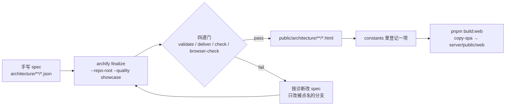

# pi-agent-web architecture-diagrams

> web 端 `/architecture` 页面：**图源 spec 进仓库 + archify 编译 + 两级切换器**。
> 本文只讲维护这套图集需要知道的事实与流程；图本身的内容是各 `*.json` spec 的事。

## 定位

一个页面承载两类图：**本平台的架构**与**原生 pi 的模块**。两者是互不隶属的知识，混在一个 tab 行里会串味（同名概念含义不同），因此数据模型里引入「集合」这一层。

三处实体，各管一件事：

| 实体 | 位置 | 角色 |
|---|---|---|
| 图源 spec（手写） | `apps/pi-agent-web/architecture/**/*.json` | **唯一事实源**：节点、连线、卡片、证据 |
| 编译产物（生成） | `apps/pi-agent-web/public/architecture/**/*.html` | 自包含单文件，被 iframe 直接加载 |
| 前端清单（手写） | `src/constants/architecture-diagrams.ts` | 集合 + 图的目录，决定 tab 顺序与 URL |

## 文件布局

```
apps/pi-agent-web/
├── src/
│   ├── constants/architecture-diagrams.ts     集合与图清单（唯一目录来源）
│   └── views/ArchitectureView.vue             两级切换器 + iframe 宿主
├── architecture/                              图源 spec（手写，进 git）
│   ├── pi-agent-platform.architecture.json
│   ├── session-prompt.sequence.json
│   ├── plugin-system.architecture.json
│   ├── capabilities.workflow.json
│   ├── capabilities.tree.json
│   ├── plugin-map.tree.json
│   └── pi/                                    ← 原生 pi 集合
│       ├── pi-lifecycle.lifecycle.json
│       ├── pi-events.sequence.json
│       ├── pi-extension-points.tree.json
│       └── pi-session-file.tree.json
└── public/architecture/                       编译产物（生成，进 git 以便 server 直接托管）
    ├── *.html
    └── pi/*.html
```

命名约定：`<slug>.<type>.html` / `<slug>.<type>.json`，`type` 是 archify 的 diagram type（`architecture` / `sequence` / `workflow` / `lifecycle` / `tree` / `erd` / `class` / `dataflow` / `timeline` / `waterfall`）。集合 `pi` 用 `pi/` 子目录隔离。

## 数据模型

```ts
interface ArchitectureCollection { id: string; label: string; hint: string; emptyHint: string; diagrams: ArchitectureDiagram[] }
interface ArchitectureDiagram    { slug: string; label: string; hint: string; type: ArchitectureDiagramType; file: string }
```

约束：

- **`slug` 全局唯一**（跨集合也不能重名）——老链接只带 `?d=`，靠 slug 反查集合
- **`file` 相对 `public/architecture/`**，集合 `pi` 写 `pi/xxx.html`
- 集合 `platform` 的第一项是默认图；集合 `pi` 的顺序即 tab 顺序
- 集合可以**为空**（渲染占位，不渲染 iframe）——加图前先占位是允许的

## URL 与运行时行为

```
/architecture?set=<collectionId>&d=<slug>
```

| 行为 | 实现 |
|---|---|
| 只有 `?d=`（老链接） | `findDiagram()` 按 slug 反查集合，仍能打开 |
| 只切集合、不带 `d` | 优先还原该集合上次看的图（`localStorage: pi-web-architecture:<collectionId>`），否则第一张 |
| 集合为空 | 不渲染 iframe，显示 `collection.emptyHint` + 集合级说明 |
| 未匹配 | 落到默认集合（`platform`）的第一张图 |

**为什么用集合而不是新路由**：切换器 / iframe 宿主 / 深链逻辑只该存在一份；「集合」是数据维度不是路由维度。单开 `/pi-architecture` 会把同一段代码复制两遍，第三个集合再复制一遍。

**为什么用 iframe**：archify 产物自带 theme、样式变量、播放/导出工具与快捷键，塞进 SPA 会与应用外壳互相污染。独立 document 是唯一稳的隔离方式（代价：图内 UI 不受 app 主题控制，它自己管）。

## 生产流程



命令（在**仓库根**执行，`--repo-root` 指向仓库根）：

```bash
node <skill>/bin/archify.mjs finalize <type> \
  platform/apps/pi-agent-web/architecture/<slug>.<type>.json \
  platform/apps/pi-agent-web/public/architecture/<slug>.<type>.html \
  --repo-root . --quality showcase --json
```

要点：

- **`finalize` 是唯一入口**：它一次跑完 `validate` → `deliver` → strict `check` → 真浏览器 `browser-check`，任一失败即停并给 `supportedFixes`
- **`browser-check` 需要真浏览器**：没有系统 Chrome 时用 `ARCHIFY_CHROME=<chrome 可执行文件>` 指到 Playwright 的 chromium，否则该门被 `skipped`、`finalize` 不算通过
- **产物必须落在 `public/` 下**：`copy-spa.mjs` 会 `rm -rf` 目标目录再整体复制，落在别处的文件进不了发布产物
- **改一次算一轮**：同一输出路径已经有浏览器证据时，重跑要带 `--out-dir <dir>/review-N`，否则旧证据与旧字节不匹配

## 证据规则（两类图不同）

| | 本平台集合 | 原生 pi 集合 |
|---|---|---|
| 节点 `sources` | **每个组件都带**（仓库相对路径 + 行号） | 无——pi 在 `node_modules`（gitignored），没有可验证的仓库来源 |
| 来源校验 | 编译时对照 `meta.repository.revision` 的**已提交字节** | 不适用 |
| 版本锚点 | `meta.repository`（url + 40 位 revision） | 标题里钉版本（如「pi 1.3.0」） |
| 结论沉淀 | 走 `doc/architecture/` | 走**本地 pi 源码知识库**（gitignored，不随仓库发布；维护方式见 `.pi/skills/pi-knowledge`） |

平台图的 `revision` 是快照：代码改了图不会自动跟着变，需要重跑 `finalize`。因此**图只反映生成时那一刻的代码**，这一点在图的标题/卡片里不重复声明，靠本条约定。

## 加一张图的 checklist

1. 写 spec 到 `architecture/<slug>.<type>.json`（集合 pi 放 `architecture/pi/`），`meta.output` 指向 `public/architecture/...`
2. 跑 `archify finalize`（带 `ARCHIFY_CHROME`），失败就按诊断改，别整体重写
3. `constants/architecture-diagrams.ts` 里对应集合的 `diagrams` 加一项（`slugs` 不能撞）
4. `pnpm build:web` → 刷新页面验证 tab 与深链
5. 平台图改完顺手核对受影响的 `doc/architecture/` 文档

## 已知约束与坑

| 现象 | 原因 / 对策 |
|---|---|
| 改完 spec 页面没变 | 产物是静态文件：必须重跑 `finalize` 再 `pnpm build:web`（或直接覆盖 `server/public/web/architecture/` 下同名文件） |
| `browser-check` 一直 `skipped` | 没系统 Chrome；`export ARCHIFY_CHROME=<path>`（Playwright chromium 在 `~/.cache/ms-playwright/chromium-*/chrome-linux/chrome`） |
| `finalize` 报 `viewer/chrome-unavailable` 以外的 `check` 失败 | 几何门禁（走线、标签间距、节点重叠）；按 `supportedFixes` 调坐标，别删语义 |
| 图太宽看不干净 | architecture 画布建议 ≤1240px（≥1.55 宽高比可到 1790px）；lifecycle 超 1395px 直接判失败；sequence 靠 `column_fit` / 自动高度 |
| 图里浮动的「路径/透镜/100%」挡住内容 | 那是 archify 前端的固定浮层，会随滚动一直浮在视口右下角，不是布局错误 |
| 页面在紧凑断点看不到入口 | 路由带 `meta.mobileHidden: true`（抽屉里不出现），且说明文字在 <860px 隐藏 |

## 相关文档

- 路由与其他页面：[pi-agent-web overview](pi-agent-web_overview.md)
- 图生成工具：archify skill（`~/.pi/agent/skills/archify`），命令与门禁见其 `SKILL.md` / `references/delivery-contract.md`
- pi 自身模块的事实来源：本地 pi 源码知识库（gitignored，不随仓库发布）
